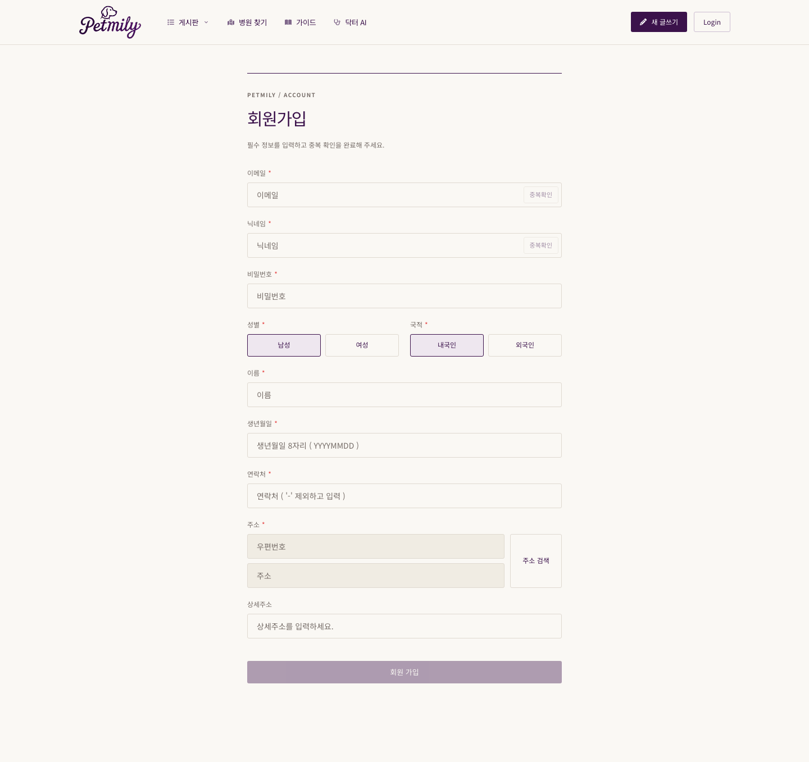
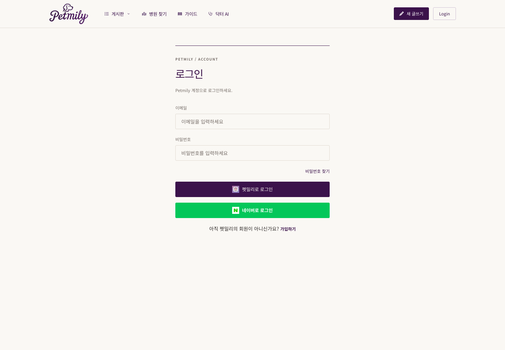
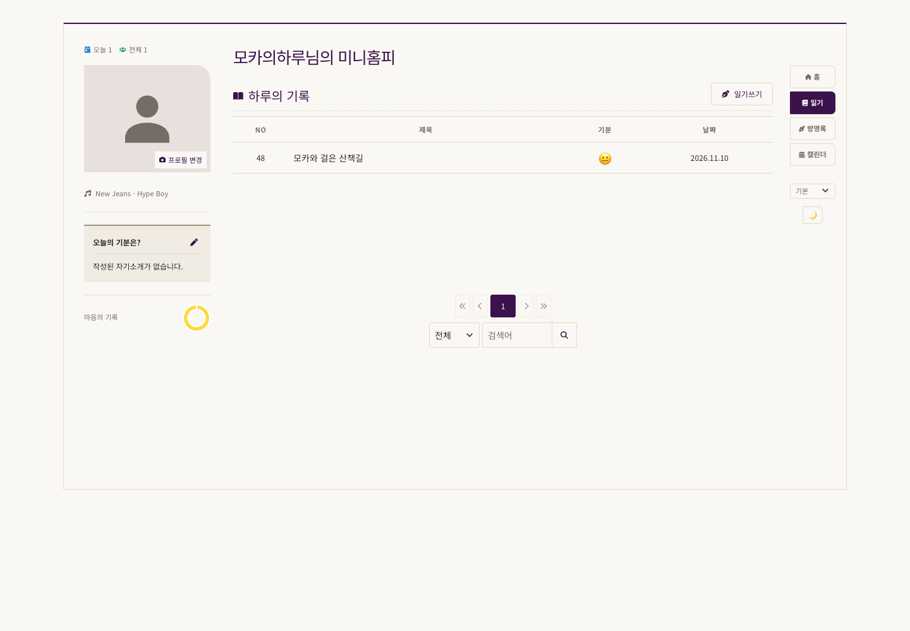
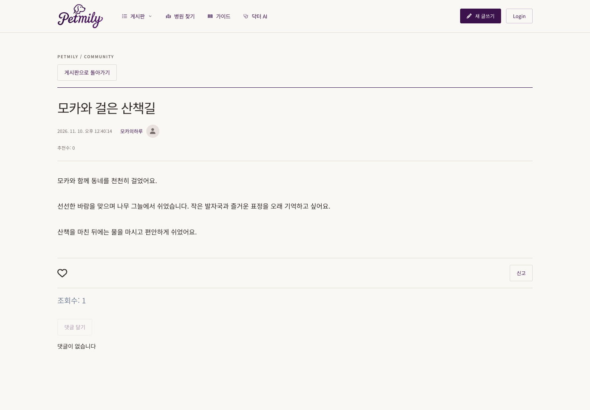
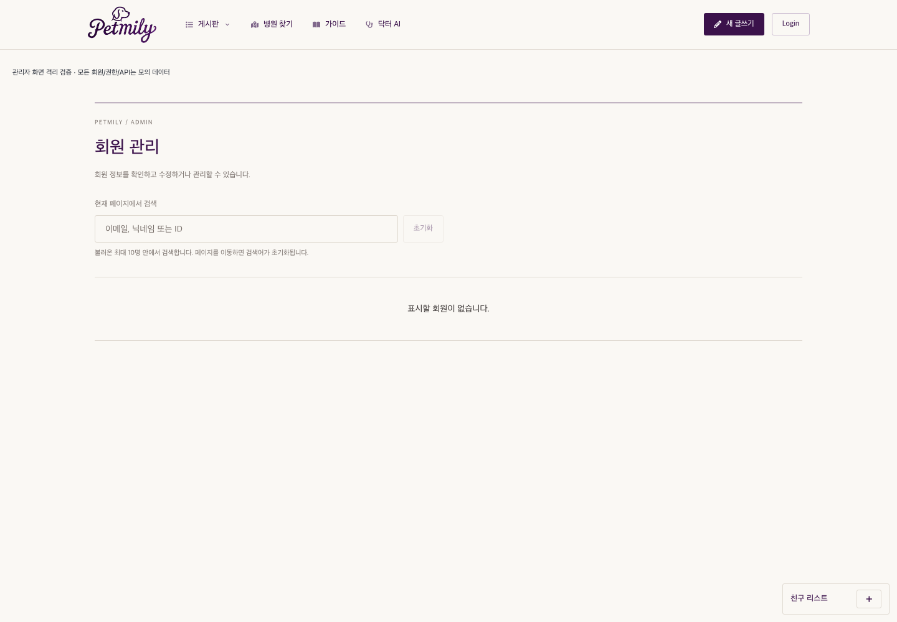
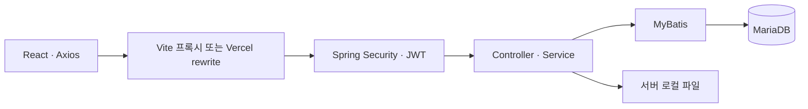

# Petmily

반려동물과 함께한 일상을 미니홈피에 기록하고, 다른 반려인과 이야기를 나누는 웹 서비스입니다.

**2024년 6~7월 · 5인 팀 프로젝트**

[웹 포트폴리오](https://parkjaewook1.github.io/portfolio/) · [포트폴리오 소스](https://github.com/parkjaewook1/portfolio)

## 프로젝트 소개

산책이나 함께 보낸 하루를 다이어리에 남기고, 캘린더에서 날짜별로 다시 볼 수 있습니다. 다른 반려인의 미니홈피를 방문해 방명록에 인사를 남기거나, 커뮤니티에서 반려생활에 관한 이야기와 정보를 나눌 수 있습니다.

## 주요 기능

화면은 2024년 팀 프로젝트가 끝난 뒤 로컬에서 캡처했습니다. 메인과 포트폴리오의 기능 화면은 2026년 11월 10일 기록이며, 회원가입과 관리자 화면은 각각 11월 5일과 9일의 UI 점검 기록입니다. 화면 예시에는 가상 콘텐츠를 사용했습니다.

### 회원가입 및 로그인

이메일과 비밀번호로 계정을 만들고 로그인할 수 있습니다.

| 회원가입 | 로그인 |
| --- | --- |
|  |  |

### 미니홈피

사용자별 공간에서 프로필과 최근 일기·방명록을 보고, 탭으로 일기와 캘린더를 오갈 수 있습니다.

### 다이어리 및 캘린더

일기를 작성·수정·삭제할 수 있고, 캘린더에서 기록한 날짜를 찾아볼 수 있습니다.

| 다이어리 | 캘린더 |
| --- | --- |
|  |  |

### 방명록

다른 사용자의 미니홈피에 인사를 남기고, 방명록 글에 답글을 달 수 있습니다.

### 커뮤니티 및 댓글

게시판에서 반려생활 정보를 나누고, 게시글에 댓글을 달 수 있습니다.

### 관리자 기능

관리자는 회원 목록을 조회하고, 삭제 조건을 충족하는 일반 회원을 삭제할 수 있습니다.

## 기술 스택

| 영역 | 기술 |
| --- | --- |
| 백엔드 |   · Spring Security, JWT, MyBatis, BCrypt |
| 프론트엔드 |   · React Router, Axios, Chakra UI, FullCalendar, Chart.js |
| 데이터베이스 |  |
| 배포 구성 |   · 서버 로컬 파일 저장 |
| 테스트 |  · MockMvc, H2, MariaDB 통합 테스트, Chrome 브라우저 검사 |

## 시스템 아키텍처 및 ERD

팀 프로젝트에서 React 화면과 Spring Boot API를 연결하고 MariaDB에 데이터를 저장했습니다. 다음 구성은 프로젝트 종료 후 정리한 API 연결과 로컬 이미지 저장 방식을 보여 줍니다.

[핵심 테이블 ERD](docs/PETMILY_TECHNICAL_DOCUMENTATION.md#5-데이터베이스와-mybatis)는 저장소 SQL을 바탕으로 회원, 미니홈피, 일기, 프로필의 관계를 보여 줍니다. [배포 및 이미지 저장 구조](docs/PETMILY_TECHNICAL_DOCUMENTATION.md#6-배포-및-이미지-저장-구조)

## 팀 구성 및 담당 역할

5인 팀에서 미니홈피의 다이어리와 방명록을 중심으로 개발했습니다.

- **다이어리** — 일기 작성·조회·수정·삭제와 캘린더 연동을 담당했습니다.
- **방명록** — 글과 답글, 목록 페이징을 구현했습니다.
- **화면 연동** — 담당 기능의 Spring Boot API 구현과 React 화면 연결에 참여했습니다.

## 프로젝트 종료 후 개인 개선

로그인과 JWT 발급, 초기 Refresh Token 교체는 팀에서 구현했습니다. 프로젝트 종료 후 기존 코드에서 다음 문제를 개선했습니다.

### 회원 조회 API의 개인정보 노출

타인 프로필 조회 응답에 비밀번호 해시와 주소가 포함됐습니다. 공개 프로필과 본인·관리자 상세에 쓰는 DTO와 SQL 조회 범위를 분리해, 타인 프로필에는 ID, 닉네임, 프로필 이미지처럼 공개에 필요한 필드만 반환하도록 수정했습니다.

### 관리자 권한 검증

관리자 권한을 JWT 발급 시점의 값으로만 판단하면, 권한이 회수된 뒤에도 기존 토큰으로 관리자 API를 호출할 수 있었습니다. 요청의 JWT 권한과 DB에 저장된 현재 권한을 함께 확인해, 관리자 권한이 회수된 뒤 들어온 요청을 차단했습니다.

### 회원 삭제 정책과 트랜잭션

연관 기록이 있는 회원을 삭제하면 기록을 보존하면서 계정만 정리하기 어렵습니다. 관리자 계정과 연관 기록이 있는 회원은 삭제를 제한하고, 삭제 가능한 일반 회원의 인증 데이터 정리와 계정 삭제를 한 트랜잭션으로 묶었습니다. 삭제에 실패하면 인증 데이터 정리도 롤백합니다.

그 밖에 JWT 권한 값과 Axios 재요청 처리, 비밀번호를 변경하지 않을 때의 해시 보존, 화면 디자인과 반응형 UI를 개선했습니다. 회원 조회·권한·비밀번호 수정·삭제는 격리 환경에서 회귀 검사했습니다.

[인증 흐름](docs/PETMILY_TECHNICAL_DOCUMENTATION.md#3-spring-security-및-jwt-인증) · [회원·관리자 처리 정책](docs/PETMILY_TECHNICAL_DOCUMENTATION.md#회원관리자-보안-개선) · [디자인·반응형 개선](docs/PETMILY_TECHNICAL_DOCUMENTATION.md#디자인반응형-개선)

## 테스트 및 검증

| 검증 시점 | 범위 | 기록 |
| --- | --- | --- |
| 회원·관리자 개선 당시 | H2·MockMvc 및 보안 단위 회귀 | 97개 통과 |
| 회원·관리자 개선 당시 | MariaDB 12.0.2 / InnoDB, 실제 HTTP | JUnit 시나리오 8개와 내부 HTTP 상태 검사 55개 통과 |
| 회원·관리자 개선 당시 | Chrome에서 React 화면 확인 | 검사 17개 통과, 런타임 예외 0건 |
| 2026년 11월 10일 | Gradle 선택 테스트·빌드 확인 | 태스크 재실행 없이 기존 결과 확인, 103개 통과·MariaDB 검사 8개 건너뜀 |
| 2026년 11월 10일 | React 빌드 | 성공, 기존 청크 크기 경고 유지 |

운영 스키마와 외부 연동은 별도 검증이 필요합니다. 공개 배포 전에는 과거 자격 증명의 사용·폐기 상태와 Kakao 지도 키 제한을 확인해야 합니다. [검증 결과와 범위](docs/publication/VERIFICATION.md) · [공개 준비 기록](docs/publication/RELEASE_READY.md)

## 로컬 실행 및 기술 문서

JDK 21, Node.js/npm, 별도의 개발용 MariaDB가 필요합니다. 개발 DB와 외부 설정 파일을 준비한 뒤 백엔드와 프론트엔드를 실행합니다.

- [로컬 실행 명령과 테스트 환경](docs/LOCAL_DEVELOPMENT.md)
- [개발용 외부 설정 예시](docs/publication/config/application.example.properties)
- [Petmily 기술 문서](docs/PETMILY_TECHNICAL_DOCUMENTATION.md)
