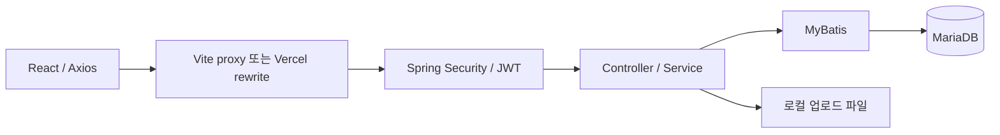

# Petmily

반려동물의 일상을 기록하고 다른 사용자와 소통하는 커뮤니티 웹 서비스입니다. **2024년 5인 팀 프로젝트**와 **프로젝트 종료 후 개인 개선 작업**을 구분해 기록합니다.

> 공개 준비 상태: 현재 작업 트리의 최신 개선 사항은 아직 커밋·푸시하지 않았습니다. SMTP 설정은 사용자 확인상 개발용 더미입니다. 현재 설정의 비밀값은 외부화했으며 과거 DB/JWT/AWS 값의 실제 사용·폐기와 카카오 콘솔 제한을 확인 중입니다. SQL 전체·키·백업·내부 검토 자료는 이번 공개 대상에서 제외합니다. [최신 반영 준비](docs/publication/RELEASE_READY.md)

## 담당 범위

| 구분 | 담당·개선 내용 |
| --- | --- |
| 2024년 6–7월 · 5인 팀 프로젝트 | 미니홈피 다이어리·방명록 중심. 일기 CRUD, 댓글·답글·페이징, 캘린더 연동과 Spring Boot API–React 연결에 참여 |
| 이후 개인 리팩토링 | 팀의 기존 인증 기반을 분석해 JWT Role 표현·Axios 재요청·댓글 SQL 매핑·이미지 저장/배포 연결을 정리 |
| 현재 개인 후속 작업 | UI 디자인 통일·반응형 개선, 회원/관리자 API 보안 결함 재현·수정, H2·MariaDB·실제 HTTP·브라우저 회귀 검사 |

초기 인증·JWT·Refresh Rotation 전체를 혼자 설계한 것으로 소개하지 않습니다. 팀 담당 범위는 기존 기술문서와 포트폴리오의 기록을 따릅니다. [이력서·면접용 설명](docs/publication/PORTFOLIO.md)

## 기능과 기술 스택

- 회원 가입·로그인·프로필, 일반 게시판과 댓글
- 사용자별 미니홈피의 일기·방명록·캘린더
- 관리자 회원 목록과 제한 삭제
- 병원/지도·친구 채팅·AI 상담 관련 코드도 포함되어 있으나 외부 연동과 전체 대화 흐름의 검증 완료를 의미하지 않습니다.

| 영역 | 실제 사용 기술 |
| --- | --- |
| Backend | Java 21, Spring Boot 3.2.6, Spring Security, JWT, MyBatis, BCrypt |
| Database | MariaDB, 테스트용 H2 |
| Frontend | React 18, Vite 5, React Router, Axios, Chakra UI |
| 화면·통신 | FullCalendar, Chart.js, Kakao Maps SDK, SockJS/STOMP |
| 파일·배포 구성 | 서버 로컬 파일 저장, Vite proxy/Vercel rewrite, VM 대상 설정 |



배포 설정이 있다는 사실과 현재 운영 서버의 가용성·배포 검증은 구분합니다. 스토리지 사용 이력, 비용 절감률·성능 향상 수치는 추가 증빙 없이 주장하지 않습니다.

## 회원·관리자 보안 개선

### 개인정보 응답 분리

기존 전체 Member 조회·직렬화에서 타인의 비밀번호 해시와 주소가 반환되는 문제를 격리 환경의 실제 HTTP로 재현했습니다. 공개/비공개 DTO와 SQL 프로젝션을 분리하고, Member 비밀번호의 JSON 출력도 차단했습니다.

| 응답 | 허용 범위 |
| --- | --- |
| 타인 프로필 | `id`, `nickname`, `imageUrl` |
| 본인 또는 현재 관리자 상세 | 수정 폼에 필요한 이메일·이름·주소·전화 등. 비밀번호·인증/복구 비밀값 제외 |
| 관리자 목록 | `id`, `username`, `nickname`, `gender`, `birthDate`, `inserted`, `role` |

공개 프로필은 필드 등급을 뜻하며, 기존 인증이 필요한 URL을 새로 익명 공개했다는 의미가 아닙니다.

### 권한 변경과 Refresh

관리자 API는 URL의 JWT 권한 검사와 서비스의 **현재 DB 관리자 권한** 검사를 함께 적용합니다. 강등이 커밋된 후의 요청에서 기존 관리자 JWT도 403으로 차단합니다. Refresh 재발급 역시 현재 DB 권한을 사용하고, 삭제된 계정과 구 Refresh 재사용을 거부합니다. Access Token 전역 denylist를 구현한 것은 아닙니다.

### 선택적 비밀번호 수정

필드 생략·null·빈 문자열은 변경 없음으로 처리합니다. 비어 있지 않은 새 비밀번호만 검증하고 BCrypt를 한 번 적용하며, MyBatis UPDATE에서 미변경 비밀번호를 제외합니다. 기존 해시 보존, 기존 비밀번호 로그인, 정상 변경 후 구 비밀번호 거부·새 비밀번호 허용을 검사했습니다.

### 관리자 삭제 정책

`DELETE /api/member/{id}`는 현재 관리자만 호출할 수 있습니다. 없는 대상은 404, 관리자 계정 또는 연관 데이터가 있는 회원은 409, 연관 데이터 없는 일반 회원의 삭제는 204입니다. 인증 행 정리와 삭제는 하나의 DB 트랜잭션이며 FK 실패 시 롤백합니다. 자동 생성된 다이어리도 연관 데이터이므로 현재는 많은 기존 계정의 삭제가 제한될 수 있습니다. 무리한 연쇄삭제나 운영 회원 삭제를 수행하지 않았습니다.

## 디자인·반응형 개선

기존 메인·Navbar와 연결되는 Modern Pet Journal 토큰/선택형 컴포넌트를 정리했습니다. 회원·게시판·미니홈피·관리자 목록·친구 위젯을 종이색, 브랜드 잉크, 얇은 구분선 중심으로 맞췄습니다. 대표 화면은 320/375/768/1440px에서 확인했고, 모바일 회원 표는 라벨이 있는 세로 정보로 표시합니다. 친구 패널·채팅창은 접힘·포커스·스크롤·화면 경계를 보완했습니다.

모든 경로·외부 SDK·상태의 리디자인/기능 검증이 완료됐다는 뜻은 아닙니다. [검증 범위](docs/publication/VERIFICATION.md)

## 검증 결과

| 구분 | 기록된 결과 |
| --- | --- |
| H2·MockMvc·보안 단위 회귀 | 97개 통과: 기존 84개 + 신규 13개 |
| MariaDB 12.0.2 / InnoDB / 실제 HTTP | JUnit 시나리오 8개, 내부 HTTP 상태 검사 55개 통과 |
| 실제 Chrome / 실제 프론트 | 검사 17개 통과, 런타임 예외 0 |
| Spring Boot·React 빌드 | 성공 |
| 관련 프론트 린트 | 기존 12 errors / 2 warnings 잔존, 시작 소스 대비 새 메시지 0 |

MariaDB 검사는 새 임시 DB·가상 계정·메모리 생성 JWT 키를 사용했습니다. 운영 DB, 운영 비밀키·실제 회원 데이터는 사용하지 않았습니다. 테스트 종류를 합쳐 전체 시스템 100% 통과로 표현하지 않습니다.

## 안전한 로컬 실행

필요 환경은 JDK 21, Node/npm, 별도의 개발용 MariaDB입니다. 현재 application 설정은 환경 변수/비공개 외부 파일을 참조합니다. 비공개 원본과 실제 자격증명은 공개 대상에서 제외합니다. 아래 예시는 저장소 밖의 개발용 설정을 명시적으로 지정합니다.

1. [비밀값 없는 외부 설정 예시](docs/publication/config/application.example.properties)를 별도 로컬 파일로 복사합니다.
2. 사용자 소유 개발 DB·스키마, JWT 키, 필요한 OAuth/메일 환경 변수를 저장소 밖에서 준비합니다. 예시는 placeholder이며 운영 값을 포함하지 않습니다. SQL 예시·백업은 출처가 확인되지 않아 공개본에서 제외하며 자동 DB 초기화를 제공하지 않습니다.
3. 전체 앱은 외부 설정으로 기존 application 파일을 **대체**해 실행합니다. 예시 경로는 프로젝트 루트 기준입니다.

```sh
cd backend
./gradlew bootJar
cd ..
java --enable-preview -jar backend/build/libs/backend-0.0.1-SNAPSHOT.jar \
  --spring.config.location=file:/absolute/path/to/your-local-application.properties
```

```sh
cd frontend
npm ci
npm run start:local
```

Vite의 기본 `/api`·`/ws` 프록시는 localhost:8080을 대상으로 합니다. DB·메일·OAuth 값과 스키마를 갖추지 않은 전체 앱의 시작 성공을 보증하지 않습니다. 외부 설정 예시 자체를 실제 외부 서비스에 연결해 검증하지 않았습니다.

운영 설정을 사용하지 않는 기존 격리 회귀는 다음으로 실행합니다.

```sh
cd backend
./gradlew test --tests 'com.backend.admin.*' build
```

MariaDB 통합 검사는 별도로 준비한 표식 있는 loopback 전용 `petmily_integration` DB가 필요합니다. 일반 회귀 실행에서는 live 검사 8개가 의도적으로 skip됩니다. 기존 전체 `contextLoads`는 실제 DB 설정을 읽을 수 있으므로 위 선택 검사와 구분합니다.

```sh
./gradlew mariaDbIntegrationTest \
  -Dpetmily.mariadb.url=jdbc:mariadb://127.0.0.1:13317/petmily_integration
```

## 미검증·공개 제약

운영 DB 스키마/트리거, 배포 HTTPS·cross-site 쿠키·프록시, 실제 OAuth·메일·업로드/탈퇴, 모든 동시 재발급·권한 변경 경쟁 상태는 별도 검증이 필요합니다. 일부 기존 UI 오류 로그와 린트 문제가 남아 있습니다. 실서비스 보안 감사·배포 승인 완료를 의미하지 않습니다.

SMTP 더미를 실제 자격증명 유출로 분류하지 않습니다. 현재 파일 외부화와 과거 이력의 실제 사용·폐기 확인은 구분합니다. JAR의 개인 키·백업 포함 문제는 패키징 제외로 수정했고, SQL 전체·비공개 설정·키·백업 원본은 공개 대상에서 제외합니다. 이번에는 staging·commit·push·이력 재작성을 하지 않았습니다. [현재 파일 목록과 남은 확인](docs/publication/RELEASE_READY.md)
