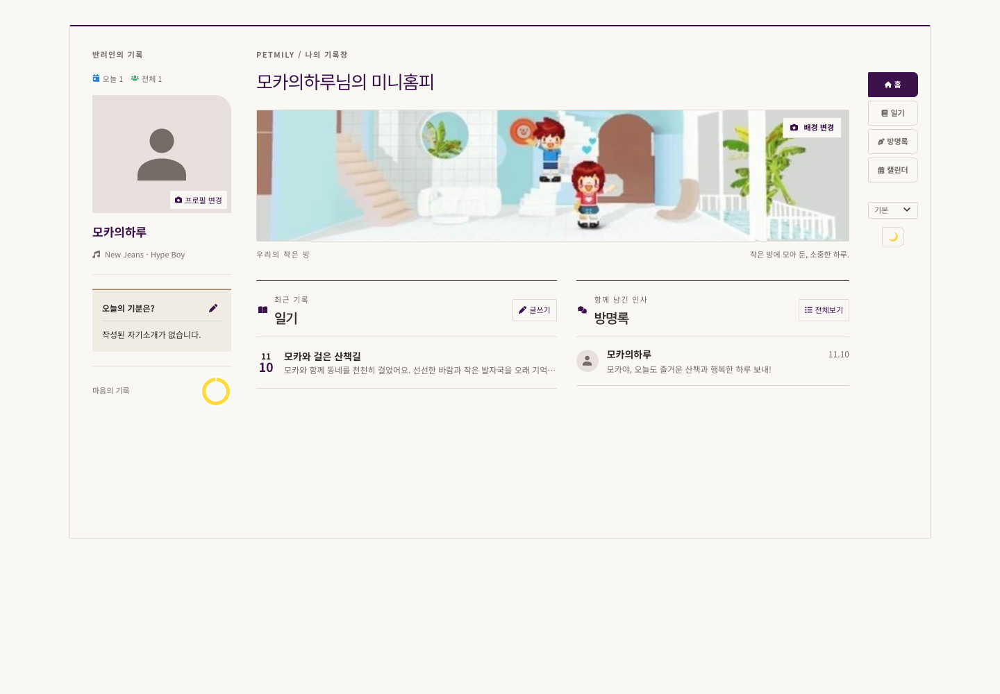
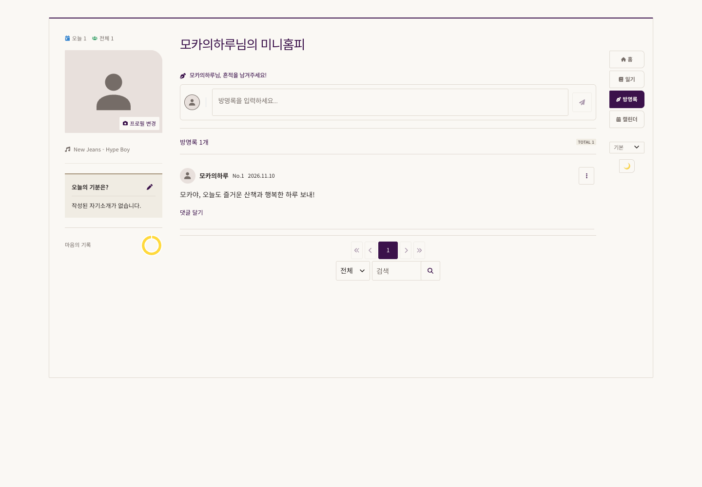
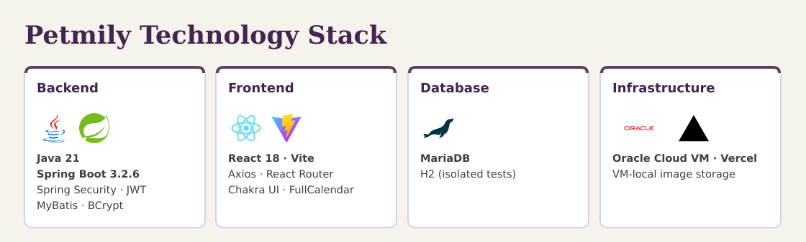

# Petmily

반려동물과 보낸 하루를 미니홈피에 기록하고, 다른 반려인과 이야기를 나누는 웹 서비스입니다.

**2024년 6–7월 · 5인 팀 프로젝트** · [웹 포트폴리오](https://parkjaewook1.github.io/portfolio/)

## 프로젝트 소개

오늘의 산책을 일기로 남기고, 캘린더에서 지난 기록을 찾아볼 수 있습니다. 미니홈피에는 내 기록이 모이고, 방명록과 커뮤니티에서는 다른 반려인과 이야기를 나눌 수 있습니다.

## 주요 기능

### 미니홈피

로그인하고 미니홈피에 들어가면 프로필과 최근 일기, 방명록을 볼 수 있습니다. 책갈피 메뉴로 일기와 캘린더를 오갈 수 있습니다.

### 다이어리 및 캘린더

산책이나 집에서 보낸 하루를 일기로 남깁니다. 목록에서 지난 글을 찾아보고, 캘린더에서 기록을 남긴 날짜를 확인합니다.

| 다이어리 | 캘린더 |
| --- | --- |
|  |  |

### 방명록

다른 사용자의 미니홈피에 들러 방명록을 남기고, 답글로 이야기를 이어갈 수 있습니다.

### 커뮤니티

게시판에서 다른 반려인의 글을 읽고, 댓글로 경험이나 정보를 나눌 수 있습니다.

화면은 프로젝트 종료 후 개선한 버전(2026년 11월 10일)이며, 가상 데이터를 사용했습니다.

## 기술 스택

## 시스템 아키텍처

React에서 보낸 API와 이미지 요청은 Vercel rewrite를 거쳐 Oracle Cloud VM의 Spring Boot로 전달하도록 구성했습니다. 데이터는 MariaDB에서 조회하고, 업로드한 이미지는 VM의 로컬 파일로 제공합니다. [아키텍처와 ERD](docs/ARCHITECTURE.md)

## 담당 역할

5인 팀에서 미니홈피의 **다이어리와 방명록**을 중심으로 개발했습니다.

- 일기 작성·조회·수정·삭제와 캘린더 연동을 담당했습니다.
- 방명록 글과 계층형 답글, 목록 페이징을 구현했습니다.
- 담당 기능의 Spring Boot API와 React 화면을 연결했습니다.

프로젝트를 마친 뒤에는 기존 인증 흐름과 회원·관리자 기능을 보완하고, 화면을 모바일에서도 읽기 쉽게 정리했습니다. [트러블슈팅 및 리팩토링](docs/TROUBLESHOOTING.md)

## 개발 문서

- [시스템 아키텍처 및 ERD](docs/ARCHITECTURE.md)
- [Spring Security와 JWT 인증](docs/AUTHENTICATION.md)
- [다이어리 및 계층형 댓글 구현](docs/FEATURES.md)
- [트러블슈팅 및 리팩토링](docs/TROUBLESHOOTING.md)
- [테스트](docs/TESTING.md)
- [로컬 실행 방법](docs/LOCAL_DEVELOPMENT.md)

[개발 문서 목차](docs/README.md)
