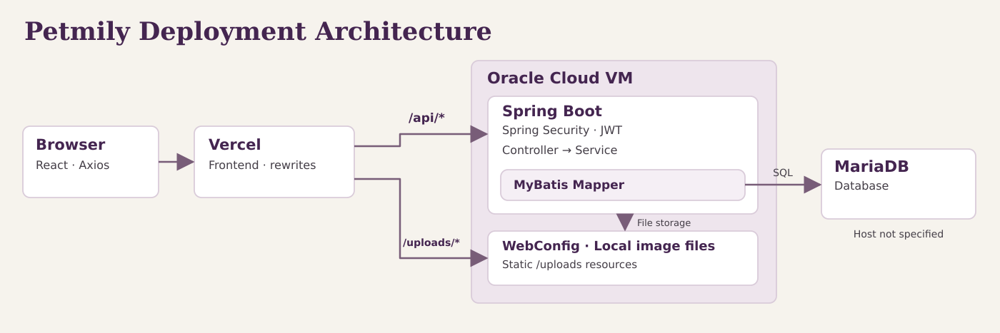
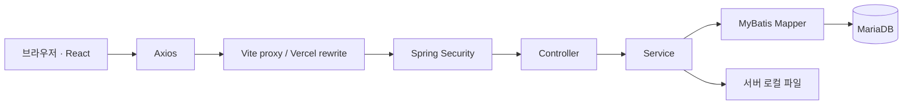
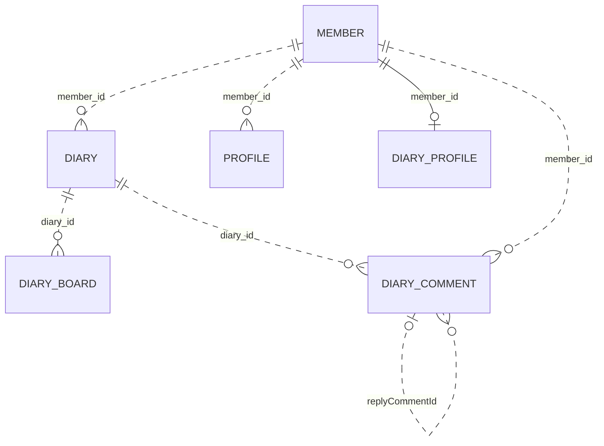

# 시스템 아키텍처

기술 스택 이미지의 로고는 [Devicon](https://github.com/devicons/devicon)에서 가져왔다.

## 요청이 오가는 경로

| 구분 | 기술 |
|---|---|
| Backend | Java 21, Spring Boot 3.2.6, Spring Security, JWT, MyBatis |
| Frontend | React, Vite, Axios, React Router, Chakra UI |
| 주요 화면 | FullCalendar, Chart.js |
| Database | MariaDB |
| 배포 | Oracle Cloud VM, Vercel |
| 파일 저장 | 서버 로컬 파일시스템 |

프론트엔드는 Axios로 API를 호출한다. 백엔드는 Spring Security가 요청을 검사한 뒤 Controller, Service, MyBatis Mapper 순서로 처리한다. 개발할 때는 [Vite proxy](../frontend/vite.config.js), 배포할 때는 [Vercel rewrite](../frontend/vercel.json)를 사용해 요청을 백엔드로 전달하도록 구성했다.

## 핵심 테이블 관계

주요 데이터는 회원(`member`), 미니홈피(`diary`), 일기(`diary_board`), 방명록(`diary_comment`)을 중심으로 연결된다. ERD는 기존 SQL 기록과 방명록 구현 문서에 나타난 논리적 관계를 간략히 나타낸다. 운영 DB 전체 스키마나 실제 FK 제약을 표현한 것은 아니다.

방명록의 각 댓글은 미니홈피와 작성자를 참조하며, 답글은 `replyCommentId`로 부모 댓글을 참조한다. [댓글 조회와 렌더링](FEATURES.md#방명록과-계층형-댓글)

## 배포 구성

백엔드는 Oracle Cloud VM, 프론트엔드는 Vercel로 분리 배포했다. [vercel.json](../frontend/vercel.json)에서 `/api/**` 요청과 `/uploads/**` 요청을 백엔드로 전달하도록 설정했다.

프로필 이미지는 [MemberService](../backend/src/main/java/com/backend/service/member/MemberService.java)에서 로컬에 저장하고 파일 정보를 DB에 기록한다. 배너 이미지는 [DiaryFileService](../backend/src/main/java/com/backend/service/diary/DiaryFileService.java)에서 저장하며, [WebConfig](../backend/src/main/java/com/backend/config/WebConfig.java)가 `/uploads/**` 경로의 정적 파일 요청을 처리한다.

### 이미지 저장 방식이 바뀐 과정

이미지 저장에는 AWS S3와 Oracle Object Storage를 사용했고, 이후 Oracle Cloud VM의 로컬 디렉터리에 파일을 저장하는 방식으로 변경했다. Azure Blob 연동 코드를 추가하고 제거한 작업도 있었지만, 실제 운영에 사용한 저장소와는 구분한다.

현재 구성에서는 프로필 이미지를 파일로 저장하고 DB에 파일 정보를 기록한다. 배너 파일은 별도 서비스에서 저장한다. 로컬 파일 방식에서는 서버를 교체하거나 복구할 때 DB만 복원해도 이미지가 돌아오지 않으므로 업로드 경로와 백업도 함께 관리해야 한다.

[Vercel rewrite](../frontend/vercel.json)의 API와 업로드 경로는 배포 설정을 보여 준다. 현재 운영의 HTTPS, 프록시와 백업 복구 상태는 [검증 범위](TESTING.md#남은-검증)에서 다룬다.
