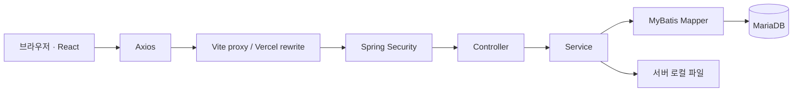
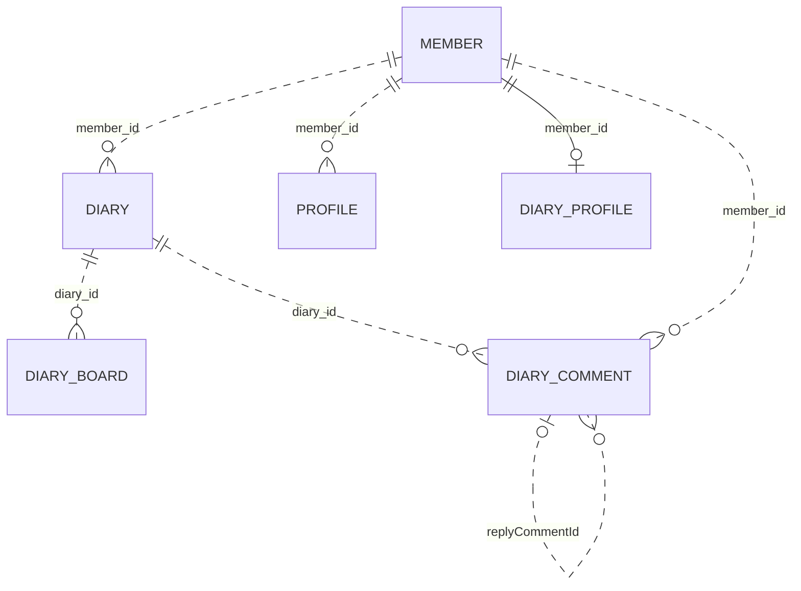

# 시스템 아키텍처

기술 스택 이미지에는 [Devicon](https://github.com/devicons/devicon)의 로고를 사용했습니다.

## 요청이 오가는 경로

| 구분 | 기술 |
|---|---|
| Backend | Java 21, Spring Boot 3.2.6, Spring Security, JWT, MyBatis |
| Frontend | React, Vite, Axios, React Router, Chakra UI |
| 주요 화면 | FullCalendar, Chart.js |
| Database | MariaDB |
| 배포 | Oracle Cloud VM, Vercel |
| 파일 저장 | 서버 로컬 파일시스템 |

React에서 Axios로 API를 호출하면 Spring Security가 요청을 확인하고, 이후 Controller에서 Service를 호출합니다. 데이터베이스가 필요한 경우 MyBatis Mapper를 통해 MariaDB에 접근합니다. 로컬 개발 환경에서는 [Vite proxy](../frontend/vite.config.js), 배포 환경에서는 [Vercel rewrite](../frontend/vercel.json)를 사용하도록 구성했습니다.

## 핵심 테이블 관계

회원(`member`), 미니홈피(`diary`), 일기(`diary_board`), 방명록(`diary_comment`)을 중심으로 주요 테이블의 관계를 정리했습니다. 아래 ERD는 논리적 관계를 표현한 것으로, 운영 DB의 전체 스키마와 실제 FK 제약까지 나타내지는 않습니다.

방명록 댓글에는 미니홈피와 작성자 정보가 연결되며, 답글은 `replyCommentId`로 부모 댓글을 참조합니다. [댓글 조회와 렌더링](FEATURES.md#방명록과-계층형-댓글)

## 배포 구성

백엔드는 Oracle Cloud VM, 프론트엔드는 Vercel에 배포했습니다. [vercel.json](../frontend/vercel.json)의 rewrite 설정으로 `/api/**` 요청과 `/uploads/**` 요청을 백엔드에 전달합니다.

### 이미지 저장 방식

기존에는 AWS S3와 Oracle Object Storage를 사용했지만, 이후 Oracle Cloud VM에 직접 파일을 저장하는 방식으로 변경했습니다.

- [MemberService](../backend/src/main/java/com/backend/service/member/MemberService.java): 프로필 이미지 저장 및 파일 정보 DB 기록
- [DiaryFileService](../backend/src/main/java/com/backend/service/diary/DiaryFileService.java): 배너 이미지 저장
- [WebConfig](../backend/src/main/java/com/backend/config/WebConfig.java): `/uploads/**` 경로를 통한 이미지 제공

서버를 이전하거나 장애가 발생했을 때 이미지를 복구하려면 DB와 업로드 파일을 별도로 백업해야 합니다.

Azure Blob은 연동 코드를 추가했다가 제거했습니다.

[운영 환경에서 추가로 확인할 사항](TESTING.md#남은-검증)
