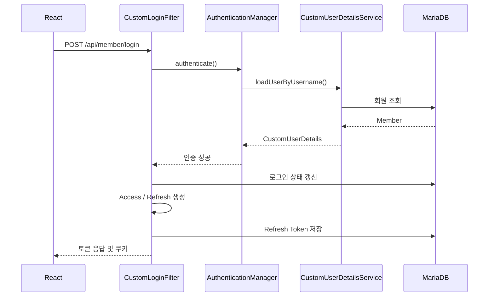

# 로그인과 토큰 처리

팀에서 로그인 필터, JWT 발급과 초기 Refresh Rotation을 구현했다. 이후 Role 표현과 Axios 재시도, 서버의 현재 권한 확인 및 토큰 교체를 보완했다.

## 로그인과 API 요청

로그인은 `POST /api/member/login`으로 요청한다. [CustomLoginFilter](../backend/src/main/java/com/backend/security/CustomLoginFilter.java)가 아이디와 비밀번호를 받아 `AuthenticationManager`에 인증을 요청하고, [CustomUserDetailsService](../backend/src/main/java/com/backend/service/member/CustomUserDetailsService.java)가 DB에서 회원 정보를 조회한다. 인증에 성공하면 Access Token과 Refresh Token을 발급한다.

로그인 후 API 요청에는 `Authorization: Bearer` 헤더로 Access Token을 보낸다. [JWTFilter](../backend/src/main/java/com/backend/security/JWTFilter.java)는 서명·만료·토큰 종류를 확인하고 `UsernamePasswordAuthenticationToken`을 `SecurityContext`에 등록한다. 로그인할 때 비밀번호를 확인하는 과정과 이후 요청에서 토큰을 확인하는 과정이 분리되어 있다.

[SecurityConfiguration](../backend/src/main/java/com/backend/config/SecurityConfiguration.java)의 공통 체인은 Stateless로 동작한다. 프로파일별 체인도 함께 존재하므로 이 절은 공통 체인의 흐름을 기준으로 설명한다.

## Refresh Token 재발급과 로그아웃

일반 로그인·재발급의 만료시간은 [JWTUtil](../backend/src/main/java/com/backend/security/JWTUtil.java) 기준 Access 2시간·Refresh 14일이다. OAuth2 성공 처리에는 10분·10시간 정책이 따로 남아 있다.

Refresh Token은 로그인 성공 시 DB의 `refresh_token` 테이블에 저장한다. `POST /api/member/reissue` 요청이 들어오면 [ReissueController](../backend/src/main/java/com/backend/controller/member/ReissueController.java)가 토큰의 유효성과 DB 저장 여부를 확인한 뒤 새 Access·Refresh Token을 발급한다. 팀 프로젝트의 초기 구현은 기존 Refresh Token을 삭제하고 새 토큰을 저장하는 기본 Rotation이었다. 당시 문서에는 교체 과정의 원자성이나 동시 요청 제어가 포함되지 않았다.

후속 개선에서는 구 토큰 삭제와 신규 토큰 저장을 하나의 DB 트랜잭션에 묶었다. 토큰의 서명·만료·종류와 저장된 Refresh, 현재 계정을 확인한다. 새 권한은 이전 토큰의 claim 대신 현재 DB에서 가져온다. 삭제된 계정의 Refresh Token과 이미 교체되어 DB에 남아 있지 않은 구 Refresh Token은 거부한다. 새 JWT에는 같은 시각에 발급돼도 값이 달라지도록 `jti`를 추가했다.

재발급 요청에 만료된 Access Token이 포함되어 있어도 `/api/member/reissue`에서는 Refresh Token을 독립적으로 검증한다. 관리자·재발급 전용 우선 필터 체인에 이 경로를 포함해 프로파일별 체인의 순서와 관계없이 동일하게 처리하도록 보완했다. 회전한 Access·Refresh Token을 프론트에서 읽을 수 있도록 CORS 요청 및 노출 헤더도 정리했다.

실제 HTTP와 브라우저 테스트에서 만료 또는 잘못된 Access 헤더가 포함된 재발급 요청을 확인했고, 교체된 구 Refresh Token의 재사용이 거부되는 것도 검증했다. 모든 동시 회전 상황이나 토큰 계열 단위의 재사용 탐지는 별도의 범위다. [관리자 권한 변경 사례](TROUBLESHOOTING.md#권한이-바뀐-계정의-기존-jwt)

로그아웃할 때는 [CustomLogoutFilter](../backend/src/main/java/com/backend/security/CustomLogoutFilter.java)가 해당 Refresh Token을 DB에서 삭제하고 쿠키를 만료시킨다. 이미 발급된 Access Token까지 즉시 무효화하는 기능은 별도로 구현하지 않았다.

## Role 값 변환과 Axios 재요청

JWT의 권한 문자열은 `ROLE_USER`, `ROLE_ADMIN` 형식이고 서버의 `Role` Enum은 `USER`, `ADMIN`이다. [JWTFilter](../backend/src/main/java/com/backend/security/JWTFilter.java)에서 `ROLE_` 접두사를 제거해 Enum으로 변환하도록 수정했다. 권한 문자열 변환과 실제 API의 접근 권한 검사는 서로 다른 단계다.

프론트엔드에서는 [axiosConfig.js](../frontend/src/api/axiosConfig.js)의 인터셉터가 Access Token을 요청 헤더에 추가한다. API에서 401 응답을 받으면 Refresh Token으로 재발급을 시도하고, 성공하면 새 Access Token으로 원래 요청을 다시 보낸다. `_retry`는 동일 요청의 반복 재시도만 막으며 여러 요청의 동시 재발급을 하나로 합치지는 않는다.

현재 토큰 저장과 인터셉터 처리는 `axiosConfig.js`와 [LoginProvider](../frontend/src/component/LoginProvider.jsx)에 나뉘어 있다. Refresh Token은 HttpOnly 쿠키 외에 JSON·헤더로도 전달되며 localStorage에도 저장된다. 따라서 스크립트를 통한 토큰 접근을 막기 위한 추가적인 보완이 필요하다.
