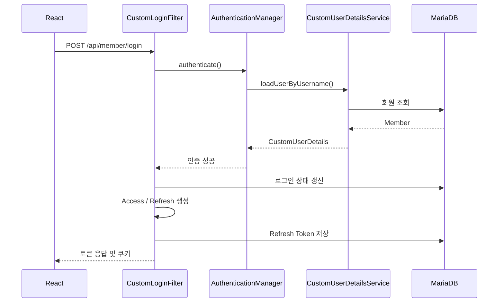

# 로그인과 토큰 처리

로그인 필터, JWT 발급과 초기 Refresh Token Rotation은 팀에서 구현했습니다. 프로젝트 종료 후 권한 처리, Axios 재시도, 현재 DB 권한 확인과 토큰 교체 방식을 개선했습니다.

## 로그인과 API 요청

로그인 요청은 `POST /api/member/login`으로 전달됩니다. [CustomLoginFilter](../backend/src/main/java/com/backend/security/CustomLoginFilter.java)에서 아이디와 비밀번호를 받아 `AuthenticationManager`에 인증을 요청하고, [CustomUserDetailsService](../backend/src/main/java/com/backend/service/member/CustomUserDetailsService.java)에서 DB의 회원 정보를 조회합니다. 인증에 성공하면 Access Token과 Refresh Token을 발급합니다.

로그인 이후에는 API 요청의 `Authorization: Bearer` 헤더에 Access Token을 담아 보냅니다. [JWTFilter](../backend/src/main/java/com/backend/security/JWTFilter.java)에서 토큰의 서명, 만료 시간과 종류를 검증하고 `UsernamePasswordAuthenticationToken`을 생성해 `SecurityContext`에 등록합니다.

[SecurityConfiguration](../backend/src/main/java/com/backend/config/SecurityConfiguration.java)의 공통 필터 체인은 Stateless 방식으로 동작합니다. 프로파일별 보안 설정도 별도로 구성되어 있습니다.

## Refresh Token 재발급과 로그아웃

일반 로그인과 재발급에서 사용하는 토큰 만료 시간은 [JWTUtil](../backend/src/main/java/com/backend/security/JWTUtil.java) 기준 Access Token 2시간, Refresh Token 14일입니다. OAuth2 로그인 성공 처리에는 각각 10분과 10시간으로 설정되어 있습니다.

로그인에 성공하면 Refresh Token을 DB의 `refresh_token` 테이블에 저장합니다. `POST /api/member/reissue` 요청이 들어오면 [ReissueController](../backend/src/main/java/com/backend/controller/member/ReissueController.java)에서 토큰의 유효성과 DB에 저장된 토큰을 확인한 뒤 Access Token과 Refresh Token을 새로 발급합니다. 팀 프로젝트에서는 기존 Refresh Token을 삭제하고 새 토큰을 저장하는 기본 Rotation을 구현했습니다. 초기 문서에는 교체 과정의 원자성과 동시 요청 제어에 대한 내용이 없었습니다.

이후 기존 Refresh Token 삭제와 새 토큰 저장을 하나의 DB 트랜잭션으로 묶었습니다. 재발급 시 토큰의 서명·만료·종류와 저장된 Refresh Token, 현재 계정을 확인합니다. 새 토큰의 권한은 이전 토큰의 claim을 그대로 사용하지 않고 현재 DB에서 조회합니다. 삭제된 계정의 Refresh Token이나 이미 교체된 Refresh Token은 거부하며, 같은 시각에 발급해도 서로 다른 토큰이 되도록 JWT에 `jti`를 추가했습니다.

Access Token이 만료된 상태에서도 재발급할 수 있도록 `/api/member/reissue`에서는 Refresh Token을 독립적으로 검증합니다. 관리자·재발급 전용 우선 필터 체인에 이 경로를 포함해 프로파일별 체인 순서에 영향을 받지 않도록 수정했습니다. 프론트엔드가 새로 발급된 토큰을 읽을 수 있도록 CORS의 허용 요청 헤더와 노출 응답 헤더도 정리했습니다.

실제 HTTP 및 브라우저 테스트에서는 만료되거나 잘못된 Access Token이 포함된 재발급 요청과, 이미 교체된 Refresh Token의 재사용이 거부되는 것을 확인했습니다. 모든 동시 재발급 상황과 토큰 계열 단위의 재사용 탐지까지 검증한 것은 아닙니다. [관리자 권한 변경 사례](TROUBLESHOOTING.md#권한이-바뀐-계정의-기존-jwt)

로그아웃하면 [CustomLogoutFilter](../backend/src/main/java/com/backend/security/CustomLogoutFilter.java)에서 해당 Refresh Token을 DB에서 삭제하고 쿠키를 만료시킵니다. 이미 발급된 Access Token은 즉시 무효화하지 않습니다.

## Role 값 변환과 Axios 재요청

JWT의 권한에는 `ROLE_USER`, `ROLE_ADMIN`을 사용하고 서버의 `Role` Enum에는 `USER`, `ADMIN`을 사용합니다. [JWTFilter](../backend/src/main/java/com/backend/security/JWTFilter.java)에서 `ROLE_` 접두사를 제거해 Enum으로 변환하도록 수정했습니다. 권한 문자열 변환과 API 접근 권한 검사는 별도로 처리합니다.

프론트엔드는 [axiosConfig.js](../frontend/src/api/axiosConfig.js)의 인터셉터를 통해 요청 헤더에 Access Token을 추가합니다. API에서 401 응답을 받으면 Refresh Token으로 재발급을 요청하고, 성공하면 새로운 Access Token으로 기존 요청을 다시 보냅니다. `_retry`는 같은 요청이 반복되는 것을 막지만, 여러 요청의 동시 재발급을 하나로 묶는 기능은 아닙니다.

토큰 저장과 인터셉터 처리는 `axiosConfig.js`와 [LoginProvider](../frontend/src/component/LoginProvider.jsx)에서 담당합니다. Refresh Token은 HttpOnly 쿠키 외에 JSON과 헤더로도 전달되며 localStorage에도 저장됩니다. XSS로 인한 토큰 노출을 줄이기 위한 추가 개선이 필요합니다.
