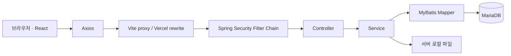
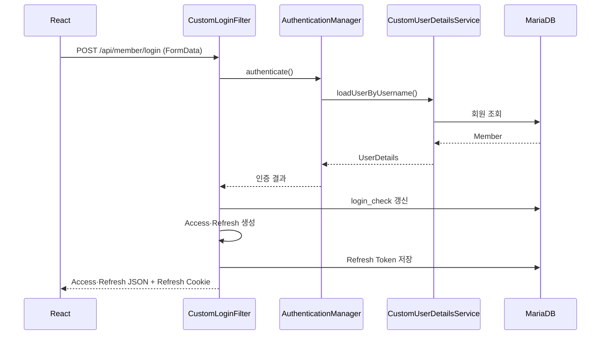
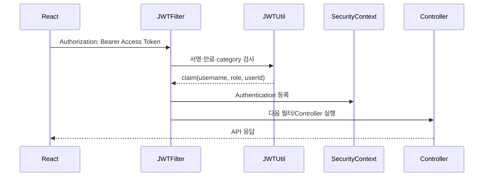
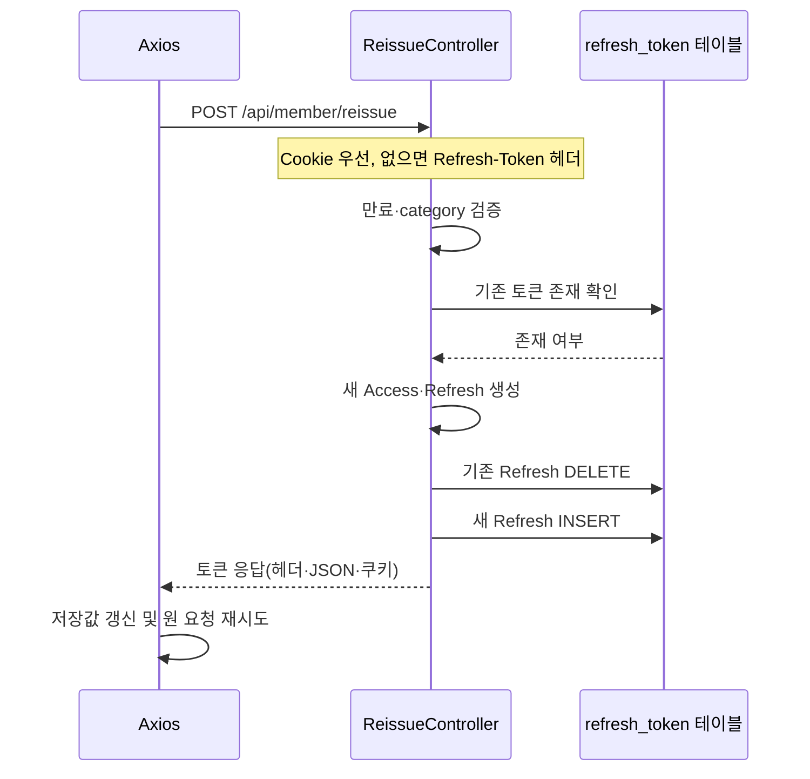
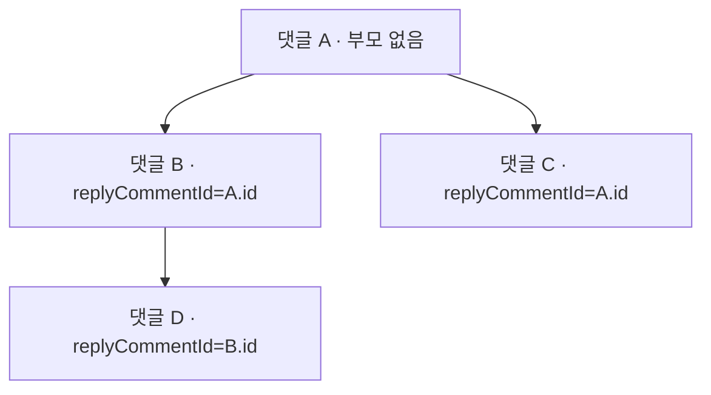
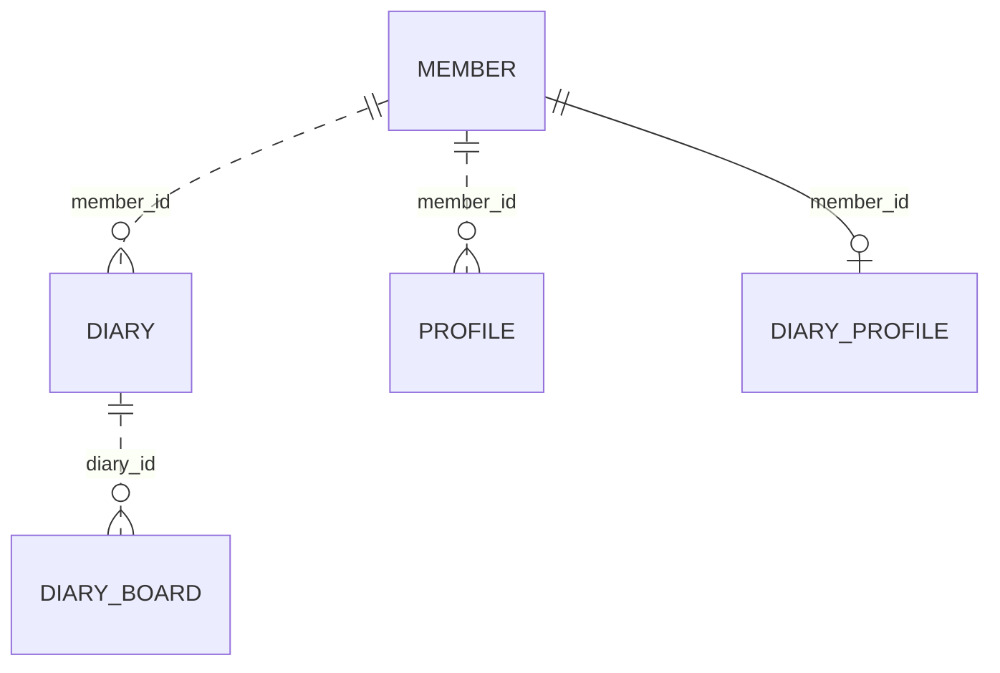
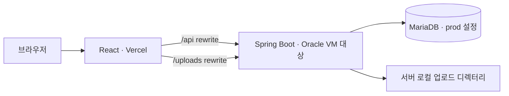

# Petmily — Technical Documentation

> 반려동물 커뮤니티 서비스의 설계·구현·개인 리팩토링 기록\
> 문서 기준: 2026-11-05 · `prj3` 소스 및 보존된 로컬 Git 이력 정적 조사\
> **검증 범위:** 코드를 통한 구조 확인과 Git diff 분석. 운영 서버, 실제 데이터베이스, 브라우저 통합 테스트는 이번 조사에 포함되지 않음.

## 목차

1. [프로젝트 소개 및 담당 범위](#1-프로젝트-소개-및-담당-범위)
2. [기술 스택](#2-기술-스택)
3. [전체 시스템 아키텍처](#3-전체-시스템-아키텍처)
4. [로그인과 요청 인증](#4-로그인과-요청-인증)
5. [Access·Refresh Token과 재발급](#5-accessrefresh-token과-재발급)
6. [권한 값과 인증 사용자 정보](#6-권한-값과-인증-사용자-정보)
7. [다이어리 설계](#7-다이어리-설계)
8. [방명록과 계층형 댓글](#8-방명록과-계층형-댓글)
9. [DB 관계와 MyBatis](#9-db-관계와-mybatis)
10. [Axios 및 프론트·백엔드 연동](#10-axios-및-프론트백엔드-연동)
11. [배포 및 이미지 저장 구조 변화](#11-배포-및-이미지-저장-구조-변화)
12. [Git 변경 이력으로 살펴본 주요 수정](#12-git-변경-이력으로-살펴본-주요-수정)
13. [검증 범위와 개선 과제](#13-검증-범위와-개선-과제)
14. [면접 대비 핵심 질문](#14-면접-대비-핵심-질문)

---

## 1. 프로젝트 소개 및 담당 범위

Petmily는 반려인의 정보 공유, 미니홈피 다이어리, 방명록 및 소통 기능을 결합한 웹 서비스다. **2024년 6~7월의 5인 팀 프로젝트**라는 배경은 사용자 제공 이력이다. 해당 기간의 여러 작성자 커밋과 종료 후 2025년 개인 코드 변경은 보존된 로컬 Git 이력에서 확인했다. Git 메타데이터만으로 팀원 수나 모든 기능의 최초 작성자를 확정하지 않는다.

| 구분 | 범위 | 근거 수준 |
|---|---|---|
| 팀 프로젝트 당시 | 미니홈피 다이어리·방명록의 개발에 참여 | 2024년 `parkjaewook1` 커밋 확인 |
| 종료 후 개인 작업 | 인증 관련 코드 변경, Axios 요청 경로 수정, Role 변환, 댓글 결과 매핑, 배포·이미지 저장 코드 변경 | 2025년 `parkjaewook1` 커밋 확인 |
| 기존 팀 구현 | 초기 JWT·Refresh Rotation, 로그인 필터와 토큰 DB 처리 기반 | 2024년 다른 팀원 커밋 확인 |
| 운영 성과·실제 장애 해결 | 별도 운영 로그와 테스트 기록 필요 | 이번 정적 조사만으로 확정 불가 |

**기여 범위를 구분하는 이유:** 현재 코드에 기능이 존재한다는 사실만으로 해당 기능의 최초 작성자가 본인이라는 뜻은 아니다. 이 문서는 *팀에서 구현한 구조의 설명*과 *종료 후 본인이 수정한 이력*을 나누어 제시한다.

### 대표 커밋

| 시점 | 커밋 | 확인된 작업 |
|---|---|---|
| 2024-06-13 | `81b9508` | 방명록 CRUD |
| 2024-06-14 | `c6bc585` | 댓글 Controller·Domain·Mapper·Service 작업 |
| 2024-06-27 | `ec92af5` | 일기 수정·삭제 관련 변경 |
| 2024-07-01 | `baf8fbd` | 캘린더·앱 리스트 변경 |
| 2025-09-11 | `0df5096` | 보안 설정, JWT, LoginProvider 등 변경 |
| 2025-11-23 | `ea96053` | Axios 인스턴스와 재시도 경로 변경 |
| 2025-12-10 | `b731a19` | JWT Role 접두사 변환 추가 |
| 2025-12-12 | `0c74b0d` | 댓글 조회 alias 추가 |

참고: 초기 Refresh Rotation 관련 커밋 `abbc8a8`은 다른 팀원의 이력이다. 문서 작성 기준 HEAD는 단일 초기 커밋 형태이며 과거 변경은 로컬 보존 참조에서 조사했다. 2026-11-05 게시 전 GitHub API 점검에서 문서의 과거 SHA 12개 중 11개는 조회 응답 200을 확인했다. `ec92af5`는 응답 422로 원격 조회를 확인하지 못했으므로, 해당 항목은 로컬 Git 이력 근거로만 제시한다. 이 확인은 과거 커밋이 현재 master의 조상이라는 의미가 아니며, 향후 원격 접근 가능성을 보증하지 않는다.

## 2. 기술 스택

| 영역 | 실제 조사에서 확인된 기술 |
|---|---|
| Backend | Java 21, Spring Boot 3.2.6, Spring Security, MyBatis Spring Boot Starter 3.0.3, JJWT 0.12.3 |
| Frontend | React 18, Vite 5, React Router, Axios, Chakra UI |
| 다이어리 UI | FullCalendar, Chart.js |
| DB | MariaDB 및 MyBatis Mapper |
| 빌드·배포 구성 | Gradle 8.7, Dockerfile, Oracle Cloud VM 대상 설정, Vercel rewrite |
| 파일 저장(현재 코드) | 애플리케이션 서버 로컬 파일시스템 |

`backend/build.gradle`, `frontend/package.json`, `frontend/package-lock.json` 기준이다. 패키지 잠금 파일의 버전은 실제 운영 서버의 라이브러리 버전을 보증하지 않는다. 일부 JPA 관련 의존성이 있어도 이 문서에서 다루는 인증·다이어리 데이터 접근은 MyBatis 기반이다.

프론트 버전은 선언 범위와 잠금 버전을 구분한다.

| 패키지 | package.json 선언 | package-lock.json 버전 |
|---|---|---|
| React | `^18.2.0` | 18.3.1 |
| Vite | `^5.2.0` | 5.4.21 |
| Axios | `^1.7.1` | 1.13.2 |
| Chakra UI | `^2.8.2` | 2.10.9 |
| React Router DOM | `^6.23.1` | 6.30.2 |
| FullCalendar React | `^6.1.14` | 6.1.19 |
| Chart.js | `^4.5.0` | 4.5.1 |

Java 21은 소스 호환성 설정이며 실제 운영 JDK 버전은 미확인이다. MariaDB 서버 버전도 미확인이다. Gradle 버전 근거는 `backend/gradle/wrapper/gradle-wrapper.properties:3`이다.

## 3. 전체 시스템 아키텍처



- 개발 환경은 Vite proxy의 `/api`·`/ws`, 배포 설정은 Vercel rewrite의 `/api`·`/uploads`를 사용한다. 두 설정의 전달 경로가 모두 같지는 않다.
- Spring Security 필터는 Controller 이전에 요청을 처리한다. 다만 실제 적용되는 SecurityFilterChain은 실행 프로파일과 체인 선택을 함께 확인해야 한다.
- `frontend/vercel.json`의 `/api`·`/uploads` rewrite는 Oracle VM 대상 서버로 전달하도록 구성되어 있다.
- 데이터베이스 설정과 파일 경로는 코드에 나타난 *설정상 구성*이며, 이번 조사에서 현재 운영 서버를 직접 접속해 확인한 것은 아니다.

공통 `SecurityConfiguration`과 프로파일별 `LocalSecurityConfiguration`·`ProdSecurityConfiguration`이 함께 존재한다. 프로파일별 설정이 공통 체인을 자동으로 대체한다고 단정할 수 없으며, 체인 적용 범위·우선순위와 실제 기동 결과를 함께 검증해야 한다. 이 검증은 아직 완료되지 않았다.

## 4. 로그인과 요청 인증

### 4.1 로그인 처리

일반 로그인 요청은 `POST /api/member/login`이며, 공통 보안 체인이 적용되는 경우 `CustomLoginFilter`가 처리한다. 프론트는 FormData를 보내고, 필터는 `request.getParameter()`로 아이디·비밀번호를 읽는다.



로그인 성공 시 Access/Refresh Token 생성, `refresh_token` INSERT, 로그인 상태 기록, JSON 응답과 Refresh Cookie 설정이 연결된다.

`SecurityConfiguration.authenticationManager()`는 `AuthenticationConfiguration.getAuthenticationManager()`를 반환하고 BCrypt 인코더 빈을 제공한다. `CustomUserDetailsService.loadUserByUsername()`은 `MemberMapper.selectByUsername()`으로 회원을 조회한다. 필터가 직접 비밀번호를 비교하는 방식은 아니며, 실제 AuthenticationProvider 구성은 런타임 확인이 필요하다.

**코드 근거:** `backend/src/main/java/com/backend/security/CustomLoginFilter.java:48` (`attemptAuthentication`), `:61` (`successfulAuthentication`), `backend/src/main/java/com/backend/service/member/CustomUserDetailsService.java:19`, `backend/src/main/java/com/backend/config/SecurityConfiguration.java:58`, `:119`.

### 4.2 로그인 후 일반 API 요청



`JWTFilter`는 Access Token 클레임으로 `CustomUserDetails`와 인증된 `UsernamePasswordAuthenticationToken`을 구성하고 요청의 `SecurityContext`에 등록한다. 세션에 사용자 정보를 영속 저장하는 설명과 구분한다. 일반 요청마다 회원 정보나 Refresh Token 존재 여부를 DB에서 다시 조회하는 구조는 아니다. Bearer 헤더가 없으면 다음 필터로 넘기며 최종 접근 허용 여부는 적용된 체인의 정책에 따른다.

JWT 오류 응답의 일관성은 추가 검증 과제다. 만료·서명·형식 오류를 포함한 실패 사례를 대상으로 예외 처리와 응답 정책을 점검해야 하며, 검증이 완료된 상태로 설명하지 않는다.

**코드 근거:** `backend/src/main/java/com/backend/security/JWTFilter.java:24`, `:81`, `backend/src/main/java/com/backend/security/JWTUtil.java:68`.

### 4.3 로그아웃 범위

`POST /api/member/logout`은 Refresh Cookie를 읽어 검증하고 DB에서 해당 Refresh Token을 삭제하며 쿠키를 만료시킨다. 이 작업은 **해당 Refresh Token으로 다시 발급받는 경로를 제한**한다. 이미 발급된 Access Token을 즉시 폐기하는 구조로 설명하지 않는다.

로그아웃은 `CustomLogoutFilter`와 프론트의 `Navbar`·`LoginProvider`에 처리가 나뉘어 있다. 토큰 전달 정책, 로그인 상태 기록, 브라우저 저장 상태를 함께 정리하는 일관된 로그아웃 정책은 추가 검증·개선 과제다. 현재 구현이 모든 인증 상태를 즉시 폐기한다고 설명하지 않는다.

**코드 근거:** `backend/src/main/java/com/backend/security/CustomLogoutFilter.java:51`, `:103`, `frontend/src/component/Navbar.jsx:110`, `frontend/src/component/LoginProvider.jsx:26`.

## 5. Access·Refresh Token과 재발급

| 구분 | 현재 일반 로그인·재발급 코드의 처리 |
|---|---|
| Access Token | 인증 API 요청에 사용, 유효기간 설정상 2시간 |
| Refresh Token | Access 재발급용, 유효기간 설정상 14일 |
| Refresh 저장 | DB `refresh_token`에 저장, 쿠키에도 전달 |
| 토큰 응답 | JSON 및 일부 응답 헤더 사용 |
| 프론트 보관 | 현재 `localStorage`에도 저장 |

`JWTUtil.java:19`의 일반 로그인·재발급은 2시간·14일이지만, `backend/src/main/java/com/backend/oauth2/CustomSuccessHandler.java:25`의 OAuth2 성공 처리는 Access 10분·Refresh 10시간이다. 전체 로그인 방식의 토큰 정책이 통일되었다고 말하지 않는다.

### 재발급 처리

`POST /api/member/reissue`는 Refresh Cookie를 우선 읽고, 없으면 `Refresh-Token` 요청 헤더를 참조한다. 토큰 만료·종류·DB 존재 여부를 검사한 뒤 새 Access/Refresh Token을 만들고 DB에서 기존 Refresh Token을 삭제한 후 새 토큰을 저장한다.



이 방식은 **기본 Refresh Token Rotation**이다. 트랜잭션에 의한 원자적 교체, 동시 재발급 충돌 제어, token family 기반 재사용 탐지는 이번 조사에서 확인되지 않았다. 인증 설계의 현재 범위를 설명할 때 이 차이를 유지해야 한다.

재발급 응답은 `access`·`Refresh-Token` 헤더, `{ access, refresh }` JSON, `refresh` 쿠키를 사용한다. 토큰 전달·보관 경로가 여러 곳에 나뉘어 있으므로 HttpOnly 쿠키 사용만으로 보안이 완전히 보장된다고 설명하지 않는다. 쿠키 속성과 브라우저 저장·리다이렉트 정책을 함께 검토하고, 토큰 노출을 최소화하는 방향으로 정리해야 한다. 이 개선은 완료된 것으로 간주하지 않으며 실제 토큰값은 문서에 싣지 않는다.

**코드 근거:** `backend/src/main/java/com/backend/controller/member/ReissueController.java:31`, `:84`, `:110`, `backend/src/main/java/com/backend/mapper/member/RefreshMapper.java:10`, `backend/src/main/java/com/backend/security/CustomLoginFilter.java:104`, `backend/src/main/java/com/backend/oauth2/CustomSuccessHandler.java:82`.

## 6. 권한 값과 인증 사용자 정보

권한 표현은 계층마다 다르다.

```text
DB / Java Role Enum: USER, ADMIN
        ↓
Spring Security Authority 및 JWT claim: ROLE_USER, ROLE_ADMIN
        ↓
JWTFilter: ROLE_ 접두사 제거
        ↓
애플리케이션 Role Enum: USER, ADMIN
```

이는 `Role.valueOf("ROLE_USER")`와 `Role.USER` 사이 표현 불일치를 처리하기 위한 값 변환이다. 이 변환이 존재한다고 해서 모든 API가 일관되게 Role과 소유자 권한을 검증하는 것은 아니다.

**개인 수정 근거:** `b731a19` (2025-12-10) — JWT Role 접두사 변환 추가.\
**코드 위치:** `backend/src/main/java/com/backend/security/JWTFilter.java`, `backend/src/main/java/com/backend/domain/member/Role.java`.

### 실제 권한 검사 범위

| 검사 방식 | 코드에서 확인한 구조와 개선 방향 |
|---|---|
| Role 기반 | Security 설정에서 `hasRole("ADMIN")` 사용. 관리자 기능 전체의 정책 일관성은 추가 검증 대상 |
| 관리자 또는 본인 | `MemberController.updateByAdminOrOwner()`에서 authority와 principal ID 검사 |
| 인증 사용자 기반 | 일기 작성 시 principal의 회원 ID로 diary 조회. 방명록은 인증 username으로 회원 조회 후 작성자·다이어리 소유자 검사 |
| 리소스 소유권 | 인증 사용자와 서버에서 조회한 대상 리소스의 소유자를 기준으로 검증 방식을 통일할 필요 |
| 공개 범위 | 소유자·PUBLIC·FRIENDS 조건을 사용하는 코드가 있으며, 관련 조회·변경 API 전체의 정책 일관성은 추가 검증 대상 |

권한 함수와 annotation의 존재만으로 모든 API의 인가 정책이 검증되었다고 설명하지 않는다. 공개 범위와 로그인 요구 여부도 별개의 정책이다. 서버 기준 소유권 확인, 메서드 보안의 활성화, 조회·변경 경로 간 일관성을 점검하는 것이 개선 방향이며 아직 해결 완료를 주장하지 않는다. 구체적인 우회 조건·재현 요청은 이 공개 문서에 포함하지 않는다.

**조사 대상:** `backend/src/main/java/com/backend/config/SecurityConfiguration.java`, `backend/src/main/java/com/backend/controller/member/MemberController.java`, `backend/src/main/java/com/backend/service/diary/DiaryBoardService.java`, `backend/src/main/java/com/backend/controller/diary/DiaryController.java`, `backend/src/main/java/com/backend/service/diary/DiaryCommentService.java`.

## 7. 다이어리 설계

### 7.1 주요 식별자

- `member.id`: 회원 PK
- `diary.id`: 회원의 미니홈피 컨테이너 PK
- `diary_board.id`: 개별 일기 PK

세 값은 서로 다른 식별자다. 프론트의 `DIARY-${memberId * 17}-ID` 형태는 사용자 ID를 변환한 문자열일 뿐 DB 다이어리 PK나 암호화된 보안 토큰이 아니다.

### 7.2 기능별 대표 API

| 기능 | HTTP / 경로 | 구성 |
|---|---|---|
| 미니홈피 조회 | `GET /api/diary/byMember/{value}` | DiaryController → DiaryService → DiaryMapper |
| 일기 작성 | `POST /api/diaryBoard/add` | DiaryBoardController → DiaryBoardService → DiaryBoardMapper |
| 일기 목록 | `GET /api/diaryBoard/list` | 목록 검색·페이징 |
| 일기 상세 | `GET /api/diaryBoard/{id}` | 단일 일기 조회 |
| 일기 수정 | `PUT /api/diaryBoard/edit` | 권한 처리 후 UPDATE |
| 일기 삭제 | `DELETE /api/diaryBoard/{id}` | 권한 처리 후 DELETE |
| 월별 감정 통계 | `GET /api/diary/mood-stats` | 일기 감정 상태 집계 |
| 방문 기록·집계 | `POST /api/diary-visit/{diaryId}`, `GET /api/diary-visit/{diaryId}/count` | 방문 서비스·Mapper |

경로는 현재 조사한 Controller 기준이다. 문서에서 이 경로를 사용한다고 해서 실제 운영 상태까지 검증됐다는 의미는 아니다.

### 7.3 하루 한 번 기록

`DiaryBoardController.addDiary()`가 인증 사용자 ID로 다이어리를 조회해 `diaryId`를 설정한다. 이후 `DiaryBoardService.add()`는 principal의 회원 ID를 설정하고 서버의 `LocalDate.now()`에 해당하는 일기 개수를 조회해 중복이면 예외를 발생시킨다. `/add`는 이 예외를 409로 변환하지만 `/add-mood`에는 동일한 예외 변환이 없다. 조사한 SQL에서 날짜별 유일성 제약은 확인되지 않아 **애플리케이션 차원의 중복 검사**이며 동시 요청까지 보장하는 DB 제약으로 설명하지 않는다.

**코드 근거:** `backend/src/main/java/com/backend/controller/diary/DiaryBoardController.java:30`, `:65`, `backend/src/main/java/com/backend/service/diary/DiaryBoardService.java:36`, `:58`, `backend/src/main/java/com/backend/mapper/diary/DiaryBoardMapper.java:223`.

### 7.4 캘린더·대시보드·감정 통계

- 캘린더: 일기 목록 응답을 FullCalendar 이벤트로 변환한다.
- 대시보드: 최근 일기 및 최상위 방명록을 각각 최대 5건 요청한다.
- 월별 감정 통계: SQL에서 `DATE_FORMAT(inserted, '%Y-%m')`로 요청 월을 필터링하고 `GROUP BY mood`로 감정별 건수를 집계한다. `DiaryHome.jsx`는 Chart.js로 표시한다.
- 반응형: Chakra UI의 화면 크기별 레이아웃과 모바일 내비게이션 분기가 존재한다.

주의: 캘린더가 보내는 `yearMonth`를 목록 Controller와 Mapper는 사용하지 않고 기본 첫 페이지 10건을 반환한다. 따라서 월 단위 전체 조회를 보장하지 않는다. 일기 첨부 파일은 프론트와 Controller에서 전달·수신하지만 현재 `DiaryBoardService.add(...files...)`는 파일 저장·메타데이터 INSERT를 호출하지 않는다. 배너의 별도 로컬 저장 기능과 구분한다.

**코드 근거:** `backend/src/main/java/com/backend/service/diary/DiaryBoardService.java:58`, `backend/src/main/java/com/backend/mapper/diary/DiaryBoardMapper.java:181`, `frontend/src/page/diary/diarySrc/diaryPage/diaryCalendar/DiaryCalendar.jsx:14`, `frontend/src/page/diary/diarySrc/diaryPage/DiaryHomeMain.jsx:77`, `frontend/src/page/diary/diarySrc/diaryPage/DiaryHome.jsx:119`, `:274`.

## 8. 방명록과 계층형 댓글

### 8.1 데이터 관계

방명록 댓글은 `replyCommentId`로 부모 댓글을 참조한다. 서버는 댓글 작성 시 부모 댓글의 존재와 동일 다이어리 소속인지 검사한다.



이 관계는 **애플리케이션에서 사용하는 논리적 부모 관계**다. DB에 self-referencing FK가 실제로 선언됐는지는 이번 조사에서 확인되지 않았다.

### 8.2 서버 응답과 React 렌더링

- `GET /api/diaryComment/list`는 `{ comments, totalPages, currentPage }` 객체를 반환한다. `comments`는 최상위 댓글 배열이며 각 항목에 직접 답글 수 `replyCount`를 설정하고 `replies`는 null로 둔다.
- `GET /api/diaryComment/all?diaryId=…`은 모든 댓글의 평면 배열이다. 프론트는 부모 목록과 이 배열을 각각 조회한다. 서버가 `children` 중첩 트리를 만들어 반환하는 방식이 아니다.
- `GET /api/diaryComment/{id}/replies`는 해당 ID의 직접 자식만 반환하며 모든 깊이의 후손을 조회하는 API는 아니다.
- 프론트는 `allComments.filter(...)`로 현재 댓글 ID를 부모로 가진 자식을 찾는다.
- `DiaryCommentItem`이 자신을 재귀 렌더링한다.
- 더보기/접기는 받아온 배열의 표시 개수를 조절한다. 최상위 댓글은 자식을 기본 3개, 더 깊은 댓글은 자식을 기본 0개 표시한다. 고정 `pl={3}`, `ml={2}`를 사용하며 depth에 비례한 동적 padding 계산은 없다.

```text
서버에서 댓글 평면 배열 조회
          ↓
현재 댓글의 자식 필터링 (replyCommentId)
          ↓
DiaryCommentItem 재귀 렌더링
          ↓
자식이 없으면 종료
```

이 구조에서는 렌더링 노드마다 전체 댓글 배열을 반복 탐색할 수 있으므로, 댓글 수가 많아졌을 때 데이터 사전 그룹화 등의 최적화를 검토할 수 있다. 서버 목록에도 부모별 답글 COUNT 호출이 있고 전체 댓글 배열을 가져오는 흐름이 있다. 데이터 무결성과 재귀 종료 조건도 함께 검증해야 한다. *실제 성능 문제가 관측되었거나 최적화가 완료되었다는 뜻은 아니다.*

서버에는 댓글 작성자 또는 다이어리 소유자를 확인하는 수정·삭제 권한 함수가 있다. 화면 버튼의 표시 조건과 서버 권한 검사는 별개이며, 식별자 의미와 권한 정책의 일치를 추가 검증해야 한다. 화면에서 버튼을 숨기는 것만으로 서버 권한이 보장되는 것은 아니다.

**코드 근거:** `backend/src/main/java/com/backend/service/diary/DiaryCommentService.java:28`, `:47`, `:82`, `backend/src/main/java/com/backend/mapper/diary/DiaryCommentMapper.java:120`, `frontend/src/page/diary/diarySrc/diaryPage/diaryComment/DiaryComment.jsx:62`, `:81`, `frontend/src/page/diary/diarySrc/diaryPage/diaryComment/DiaryCommentItem.jsx:53`, `:60`, `:113`.

## 9. DB 관계와 MyBatis

### 9.1 확인된 핵심 관계



위 선은 조사한 SQL에 정의가 확인된 일부 관계를 나타낸다. 최신 운영 DB에서 `SHOW CREATE TABLE`로 재확인한 ERD는 아니다. `diary_comment`, `diary_visit`, `diary_file` 등의 관계는 실제 DDL이 확보되면 확장할 예정이다.

**DDL 근거:** `backend/sql/diary.sql:139`, `:169`, `:180`, `backend/sql/profile.sql:3`. SQL 파일에는 여러 시점의 CREATE·ALTER·DROP이 섞여 있어 재현 가능한 최신 마이그레이션으로 간주하지 않는다. `diary.member_id`의 UNIQUE는 미확인이다. `visibility`와 `inserted_date`는 현재 Mapper에서 사용하지만 해당 컬럼의 최신 DDL은 이 자료에서 확인되지 않는다.

### 9.2 주요 테이블

| 테이블 | 역할 |
|---|---|
| `member` | 회원, 로그인 식별자 및 권한 |
| `diary` | 미니홈피 컨테이너, 공개 범위 |
| `diary_board` | 일기 본문, 날짜, 감정 |
| `diary_comment` | 방명록 댓글, 부모 댓글 참조 |
| `diary_file` | 파일 관련 과거 SQL/Mapper 구조 |
| `diary_profile` | 다이어리 상태 메시지·소개 |
| `diary_visit` | 방문 기록·집계 |
| `refresh_token` | Refresh Token 저장 및 재발급 여부 확인 |
| `profile` | 프로필 이미지 메타데이터 |

### 9.3 Mapper의 데이터 매핑

MyBatis는 SQL의 컬럼명과 Java 객체의 프로퍼티를 연결한다. 현재 설정에는 `map-underscore-to-camel-case`가 있고, 댓글 조회에서는 `AS memberId`, `AS diaryId`, `AS replyCommentId` 등의 alias를 사용한다.

```sql
-- 형태 설명용 예시. 원본 SQL을 그대로 복사한 문장은 아님.
SELECT
  comment_id AS id,
  reply_comment_id AS replyCommentId,
  member_id AS memberId,
  diary_id AS diaryId
FROM diary_comment;
```

**개인 수정 근거:** `0c74b0d` (2025-12-12) — 댓글 조회 결과에 `memberId`, `diaryId` alias 추가. 해당 변경이 실제 어떤 장애를 해결했는지는 오류 기록이나 재현 자료로 검증할 필요가 있다.

## 10. Axios 및 프론트·백엔드 연동

`frontend/src/api/axiosConfig.js`의 공통 Axios 인스턴스는 상대 경로를 사용하며, 프론트가 `/api/...` 요청을 보낸다. 개발 환경과 배포 환경에서 각각 프록시/rewrite가 뒤쪽 서버로 연결한다.

| 단계 | 코드 흐름 |
|---|---|
| 일반 요청 | `localStorage.accessToken`을 읽어 Bearer 헤더 추가 |
| 401 응답 | 원 요청에 `_retry` 플래그 설정 |
| 재발급 요청 | `Refresh-Token` 헤더 등으로 서버 재발급 요청 |
| 성공 응답 | 새 토큰을 저장하고 기존 요청 재시도 |
| 첨부 요청 | 필요한 경우 FormData 재구성 |

`_retry`는 **한 요청의 반복 재시도를 방지하는 플래그**이지, 여러 요청이 동시에 401을 받았을 때 재발급을 하나로 합치는 전역 동시성 제어는 아니다.

현재 `LoginProvider`에도 별도의 Axios 인터셉터·토큰 저장 흐름이 있어, 토큰 상태 관리가 한 곳으로 완전히 통일된 구조는 아니다.

**개인 수정 근거:** `ea96053` (2025-11-23) — Axios 인스턴스 및 재시도 경로 수정.\
**코드 근거:** `frontend/src/api/axiosConfig.js:14`, `:43`, `:57`, `:69`, `frontend/src/component/LoginProvider.jsx:34`, `:73`, `:89`.

공통 인스턴스는 재발급 응답 JSON이 아니라 `headers.access`와 `headers["refresh-token"]`을 읽는다. 반면 Provider는 `memberInfo.access`를 별도로 갱신하며 만료 타이머도 유지한다. 공통 재발급이 `accessToken`만 갱신하는 경우와 상태 불일치 가능성을 함께 검증해야 한다.

Security CORS 설정의 노출 헤더에는 `access`가 있지만 `Refresh-Token`은 없다. MVC CORS 설정의 허용 origin·노출 헤더도 다르므로 직접 cross-origin 호출과 동일 origin rewrite 호출을 구분해야 한다. `Set-Cookie`를 노출 목록에 적어도 JavaScript가 그 헤더를 읽을 수 있는 것은 아니다. 이 절은 코드 흐름 설명이며 운영 재발급 성공의 증빙이 아니다.

**CORS 근거:** `backend/src/main/java/com/backend/config/SecurityConfiguration.java:74`, `backend/src/main/java/com/backend/config/CorsConfiguration.java:10`.

## 11. 배포 및 이미지 저장 구조 변화

### 11.1 현재 코드의 설정상 구성



- `frontend/vercel.json`: `/api/**`, `/uploads/**`와 SPA 경로 rewrite.
- `WebConfig`: `/uploads/**`를 서버의 고정된 절대 업로드 디렉터리에 연결하도록 설정. 실제 서버 경로는 공개 문서에서 생략한다.
- 프로필 및 배너: 현재 코드에서는 로컬 파일 저장 처리 존재. 배너 API의 `{id}`는 DB 갱신에 사용되지 않고 저장 URL만 반환한다.
- `backend/Dockerfile`: Java 21 애플리케이션 실행 구성.

설정상 경로와 파일 실제 저장 경로가 운영 환경에서 일치하는지는 외부 환경변수·볼륨 설정으로 추가 확인해야 한다. **현재 VM에서 정상 서비스 중임을 이 정적 코드 조사만으로 확정할 수는 없다.**

배너 저장은 `file.upload-dir`에 기본값이 있지만 프로필 저장은 해당 설정값을 요구한다. 추적된 설정만으로 실제 주입값과 정적 매핑의 일치를 확정할 수 없다. `backend/mybuild.sh`에는 프론트 빌드를 JAR에 포함해 다른 서버에 배포하는 경로가 남아 있으므로 현재 Vercel 분리 배포 절차로 단정하지 않는다. 스크립트와 Dockerfile의 존재는 실제 배포 실행 증거가 아니다.

**코드 근거:** `backend/src/main/java/com/backend/config/WebConfig.java:12`, `backend/src/main/java/com/backend/service/diary/DiaryFileService.java:18`, `backend/src/main/java/com/backend/controller/diary/DiaryController.java:195`, `backend/src/main/java/com/backend/service/member/MemberService.java:47`, `:103`, `frontend/vercel.json:2`, `backend/Dockerfile:1`.

### 11.2 스토리지 사용 이력의 구분

| 경험/구조 | 현재 확보된 근거 | 문서화 원칙 |
|---|---|---|
| AWS S3 | 2024년 `S3Client`와 이전 프로필 저장 코드 | 과거 연동 코드 확인됨 |
| Azure Blob Storage | 2025년 코드 diff에 Blob 업로드·삭제 코드 | 과거 코드 존재. 실제 운영 사용 여부는 별도 확인 |
| Oracle Object Storage | 사용자가 설명한 과거 사용 경험 — 소스 증빙 추가 필요 | 다른 저장소와의 사용 순서·운영 시점을 확정하지 않음 |
| Oracle VM 로컬 파일 | 현재 `MemberService`와 `WebConfig`, 변경 이력 | 현재 코드의 저장 방식으로 설명 가능 |

`5ca46f2`의 프로필 저장 diff에는 S3 호출을 Azure Blob 호출로 바꾼 내용이 있다. 이는 코드 변경 순서의 근거이며 Azure의 실제 운영 사용·데이터 이전 완료 증거는 아니다. Oracle Object Storage를 포함한 전체 사용 순서는 추가 증빙 전까지 확정하지 않는다.

외부 저장소의 관리 비용 및 구성을 검토하며 로컬 파일 저장 방식으로 변경했다는 것은 **사용자가 설명한 전환 배경**이다. 실제 비용 절감 금액·비율이나 성능 개선은 측정 자료가 확보되기 전까지 결과로 주장하지 않는다.

**코드·이력 근거:** `9d4de1b` (S3), `5ca46f2` (저장 코드 변경), `cb26b24` (Azure 클라이언트 제거), `backend/src/main/java/com/backend/service/member/MemberService.java`, `backend/src/main/java/com/backend/config/WebConfig.java`.

## 12. Git 변경 이력으로 살펴본 주요 수정

> 아래는 *Git diff로 확인된 코드 변경*이다. 실제 장애를 재현·해결했다는 기록이 없는 항목은 '문제 해결 완료'가 아니라 '변경 사례'로 설명한다.

### 사례 A. JWT 권한 문자열과 Enum 표현 차이

- **상황:** JWT 권한 문자열은 `ROLE_USER` 형태이지만 애플리케이션 Enum은 `USER`를 사용한다.
- **변경:** JWTFilter에서 `ROLE_` 접두사를 제거해 Enum으로 변환하는 처리가 추가되었다.
- **증빙:** `b731a19` (2025-12-10).
- **추가 검증:** 변경 전후 실패 응답과 정상 인증 테스트 기록.

### 사례 B. Axios 재발급 후 요청 경로 변경

- **상황:** Access Token 만료 후 재발급과 원 요청 재시도 경로를 다룬다.
- **변경:** Axios 인스턴스·인터셉터·재시도 경로와 관련된 코드 변경이 확인되었다.
- **증빙:** `ea96053` (2025-11-23).
- **추가 검증:** 동시 401, 쿠키/헤더 조합, 실제 브라우저 응답과 토큰 저장 일관성.

### 사례 C. 방명록 JOIN 결과의 alias 보강

- **상황:** 댓글 응답의 회원 ID·다이어리 ID를 프론트에서 참조한다.
- **변경:** SQL 조회 결과에 `AS memberId`, `AS diaryId`를 추가했다.
- **증빙:** `0c74b0d` (2025-12-12).
- **추가 검증:** API 응답 JSON 비교 및 관련 화면 재현.

### 사례 D. 파일 저장 코드의 변경

- **상황:** 외부 객체 저장소 연동과 서버 로컬 저장 방식의 차이를 다룬다.
- **변경:** 과거 S3 및 Azure Blob 관련 코드와 현재 로컬 저장 코드가 확인된다.
- **증빙:** `9d4de1b`, `5ca46f2`, `cb26b24`.
- **추가 검증:** 각 저장소의 실제 사용 시점, 배포 이력, 현재 업로드 경로와 백업 정책.

## 13. 검증 범위와 개선 과제

이 문서의 설명은 **정적 코드 확인**과 **Git 이력**을 기반으로 한다. 다음 항목은 검증 완료된 운영 성과가 아니라 추후 개선·테스트 과제다.

| 우선순위 | 과제 | 이유 |
|---|---|---|
| 높음 | 인증·인가 테스트 및 정책 일관성 | API별로 인증 사용자와 대상 리소스 소유자 검증 방식을 통일할 필요 |
| 높음 | 보안 로그·토큰 취급 점검 | 비밀정보가 로그·응답에 불필요하게 노출되지 않도록 점검 |
| 높음 | Refresh Token 교체의 원자성·동시성 검증 | 여러 재발급 요청이 겹치는 상황과 실패 처리 검증 |
| 중간 | Axios 토큰 관리 단일화 | 인터셉터와 저장소 간 중복 상태를 정리할 필요 |
| 중간 | 다이어리 일일 작성 정책의 DB 제약 검토 | 동시 요청과 무결성 보장 범위 점검 |
| 중간 | 업로드 저장 경로·백업 정책 정리 | 서버 교체 및 재배포 시 파일 보존 확인 |
| 중간 | 실제 운영 DB DDL·ERD 확보 | 논리 관계와 선언된 FK의 일치 확인 |
| 중간 | 캘린더 월별 조회·첨부 이미지 처리 검증 | UI가 기대하는 데이터와 실제 API 반환 범위 점검 |

공개 문서에는 실제 토큰·패스워드·비밀키·운영 IP·접속 명령·실제 서버 저장 경로와 구체적인 권한 우회 절차·재현 요청을 싣지 않는다. 인증 관련 로그를 증빙으로 인용할 때는 비밀정보를 제거해야 하며, 로그 정책과 토큰 취급은 추가 개선 과제로 남아 있다. 이 검토에서 소스는 수정하지 않았으며 저장소 전체의 비밀정보 부재나 보안 문제 해결을 보증하지 않는다.

문서 형식 검토에서는 Mermaid 11.4.1 파서로 다이어그램 7개의 구문을 확인하고, GitHub 방식의 heading slug와 목차 링크 14개를 대조했다. GitHub 웹 화면에서의 실제 렌더링과 운영 동작은 별도 검증 범위다.

## 14. 면접 대비 핵심 질문

**Q1. 로그인과 일반 API 요청의 인증 처리는 어떻게 다른가?**\
로그인은 `CustomLoginFilter`가 `AuthenticationManager`를 통해 자격 증명을 확인한다. 이후 요청은 JWTFilter가 Access Token을 검증하고 `SecurityContext`에 인증 객체를 등록한다.

**Q2. Refresh Token을 DB에 두는 이유는?**\
재발급 시 서버에서 토큰 존재 여부를 확인하고 특정 Refresh Token을 삭제해 이후 재발급을 제한할 수 있다. 다만 이는 기존 Access Token의 즉시 무효화와 다르다.

**Q3. 기본 Refresh Token Rotation과 고급 재사용 탐지는 무엇이 다른가?**\
현재는 이전 Refresh Token을 삭제하고 새 토큰을 저장하는 구조다. 원자성·동시성 제어와 토큰 계열 재사용 탐지는 별도의 설계가 필요하다.

**Q4. `ROLE_USER`와 `USER`는 왜 다르게 다루는가?**\
Spring Security Authority 표현과 도메인 Enum 표현이 다르기 때문이다. JWT 파싱 단계에서 정규화하여 Enum으로 변환하는 코드를 확인했다.

**Q5. 계층형 방명록 댓글은 DB와 화면에서 어떻게 표현되는가?**\
댓글에는 부모를 가리키는 `replyCommentId`가 있고 서버는 평면 목록을 반환한다. React는 각 댓글의 자식을 필터링해 동일 컴포넌트를 재귀 렌더링한다.

**Q6. 외부 Object Storage와 VM 로컬 파일 저장을 어떻게 비교하는가?**\
연동 방식, 비용 항목, 파일 영속성, 백업·복구, 수평 확장과 다중 서버 공유 가능성을 비교한다. 현재 프로젝트에서는 로컬 파일 저장 코드가 확인된다.

---

## 참고한 소스 및 조사 메모

- [backend/build.gradle](../backend/build.gradle), [frontend/package.json](../frontend/package.json), [frontend/package-lock.json](../frontend/package-lock.json)
- [backend/src/main/java/com/backend/config/SecurityConfiguration.java](../backend/src/main/java/com/backend/config/SecurityConfiguration.java)
- [backend/src/main/java/com/backend/config/LocalSecurityConfiguration.java](../backend/src/main/java/com/backend/config/LocalSecurityConfiguration.java)
- [backend/src/main/java/com/backend/config/ProdSecurityConfiguration.java](../backend/src/main/java/com/backend/config/ProdSecurityConfiguration.java)
- [backend/src/main/java/com/backend/security/CustomLoginFilter.java](../backend/src/main/java/com/backend/security/CustomLoginFilter.java)
- [backend/src/main/java/com/backend/security/JWTFilter.java](../backend/src/main/java/com/backend/security/JWTFilter.java)
- [backend/src/main/java/com/backend/security/CustomLogoutFilter.java](../backend/src/main/java/com/backend/security/CustomLogoutFilter.java)
- [backend/src/main/java/com/backend/security/JWTUtil.java](../backend/src/main/java/com/backend/security/JWTUtil.java)
- [backend/src/main/java/com/backend/controller/member/ReissueController.java](../backend/src/main/java/com/backend/controller/member/ReissueController.java)
- [backend/src/main/java/com/backend/mapper/member/RefreshMapper.java](../backend/src/main/java/com/backend/mapper/member/RefreshMapper.java)
- [frontend/src/api/axiosConfig.js](../frontend/src/api/axiosConfig.js), [frontend/vercel.json](../frontend/vercel.json)
- [frontend/src/page/diary/diarySrc/diaryPage/diaryComment/DiaryCommentItem.jsx](../frontend/src/page/diary/diarySrc/diaryPage/diaryComment/DiaryCommentItem.jsx)
- 다이어리·댓글 Controller, Service, MyBatis Mapper 및 `backend/sql/*.sql`
- Git 이력 정적 조사 보고서(A~L), 2026-11-05 기준

> **문서 업데이트 규칙:** 코드 수정으로 구현이 바뀌면 이 문서의 설명·다이어그램을 함께 갱신한다. 코드에서 확인된 동작, 사용자 경험, 런타임 검증 결과는 서로 구분해 기록한다.
