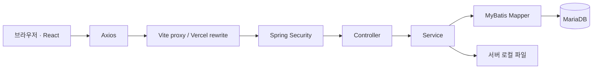
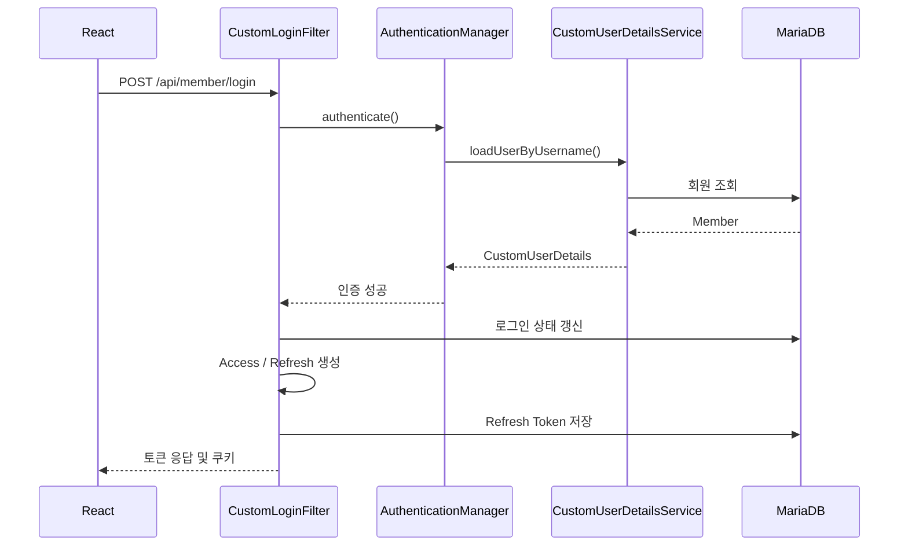
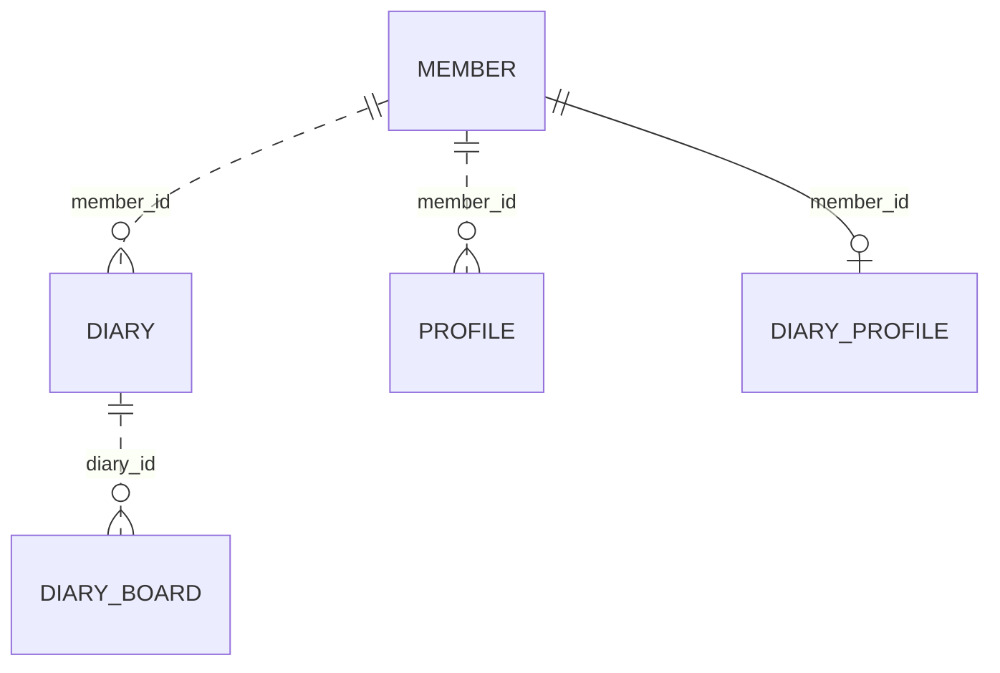

# Petmily 기술문서

2024년 팀 프로젝트에서 담당했던 다이어리·방명록 기능과, 프로젝트 종료 후 개인적으로 수정한 인증·배포 관련 코드를 정리했습니다. 기능의 동작 방식은 현재 소스코드를 기준으로 설명합니다.

## 목차

1. [프로젝트 소개 및 담당 범위](#1-프로젝트-소개-및-담당-범위)
2. [기술 스택과 시스템 아키텍처](#2-기술-스택과-시스템-아키텍처)
3. [Spring Security 및 JWT 인증](#3-spring-security-및-jwt-인증)
4. [다이어리와 계층형 댓글](#4-다이어리와-계층형-댓글)
5. [데이터베이스와 MyBatis](#5-데이터베이스와-mybatis)
6. [배포 및 이미지 저장 구조](#6-배포-및-이미지-저장-구조)
7. [주요 리팩토링 및 코드 변경 사례](#7-주요-리팩토링-및-코드-변경-사례)
8. [회원·관리자 보안 개선](#회원관리자-보안-개선)
9. [디자인·반응형 개선](#디자인반응형-개선)

## 1. 프로젝트 소개 및 담당 범위

Petmily는 반려동물의 일상을 기록하고 다른 사용자와 소통할 수 있는 커뮤니티 웹 서비스입니다. 2024년 6~7월에 5명이 팀을 이루어 개발했습니다.

팀 프로젝트 당시에는 **미니홈피 다이어리와 방명록**을 주로 담당했습니다. 일기 작성·조회·수정·삭제, 댓글과 답글, 페이징, 캘린더 연동 작업에 참여했습니다.

프로젝트 종료 후인 2025년에는 기존 코드를 다시 살펴보며 개인 리팩토링을 진행했습니다. 팀원이 구현한 초기 JWT 인증·Refresh Rotation 구조를 바탕으로 Role 값 변환과 Axios 요청 처리, 댓글 SQL 매핑, 배포 및 이미지 저장 관련 코드를 수정했습니다. 아래에서는 현재 구현을 설명하고, 제가 변경한 부분은 마지막 장에서 따로 정리했습니다.

## 2. 기술 스택과 시스템 아키텍처

| 구분 | 기술 |
|---|---|
| Backend | Java 21, Spring Boot 3.2.6, Spring Security, JWT, MyBatis |
| Frontend | React, Vite, Axios, React Router, Chakra UI |
| 주요 화면 | FullCalendar, Chart.js |
| Database | MariaDB |
| 배포 | Oracle Cloud VM, Vercel |
| 파일 저장 | 서버 로컬 파일시스템 |



프론트엔드는 Axios로 API를 호출하고, 백엔드에서는 Spring Security가 요청을 검사한 뒤 Controller, Service, MyBatis Mapper 순서로 처리합니다. 개발할 때는 [Vite proxy](../frontend/vite.config.js), 배포할 때는 [Vercel rewrite](../frontend/vercel.json)를 사용해 요청을 백엔드로 전달하도록 구성했습니다.

## 3. Spring Security 및 JWT 인증

### 로그인과 API 요청

로그인은 `POST /api/member/login`으로 요청합니다. [CustomLoginFilter](../backend/src/main/java/com/backend/security/CustomLoginFilter.java)가 아이디와 비밀번호를 받아 `AuthenticationManager`에 인증을 요청하고, [CustomUserDetailsService](../backend/src/main/java/com/backend/service/member/CustomUserDetailsService.java)가 DB에서 회원 정보를 조회합니다. 인증에 성공하면 Access Token과 Refresh Token을 발급합니다.



로그인 후 API 요청에는 `Authorization: Bearer` 헤더로 Access Token을 보냅니다. [JWTFilter](../backend/src/main/java/com/backend/security/JWTFilter.java)는 서명·만료·토큰 종류를 확인하고 `UsernamePasswordAuthenticationToken`을 `SecurityContext`에 등록합니다. 로그인할 때 비밀번호를 확인하는 과정과 이후 요청에서 토큰을 확인하는 과정이 분리되어 있습니다.

[SecurityConfiguration](../backend/src/main/java/com/backend/config/SecurityConfiguration.java)의 공통 체인은 Stateless로 동작합니다. 프로파일별 체인도 함께 존재하므로 이 절은 공통 체인의 흐름을 기준으로 설명합니다.

### Refresh Token 재발급과 로그아웃

일반 로그인·재발급의 만료시간은 [JWTUtil](../backend/src/main/java/com/backend/security/JWTUtil.java) 기준 Access 2시간·Refresh 14일입니다. OAuth2 성공 처리에는 10분·10시간 정책이 따로 남아 있습니다.

Refresh Token은 로그인 성공 시 DB의 `refresh_token` 테이블에 저장합니다. `POST /api/member/reissue` 요청이 들어오면 [ReissueController](../backend/src/main/java/com/backend/controller/member/ReissueController.java)가 토큰의 유효성과 DB 저장 여부를 확인한 뒤 새 Access·Refresh Token을 발급합니다. 기존 Refresh Token을 삭제하고 새 토큰을 저장하는 **기본 Rotation 방식**입니다. DB 교체의 원자성·동시성 제어와 토큰 계열의 재사용 탐지는 포함하지 않습니다.

로그아웃할 때는 [CustomLogoutFilter](../backend/src/main/java/com/backend/security/CustomLogoutFilter.java)가 해당 Refresh Token을 DB에서 삭제하고 쿠키를 만료시킵니다. 이미 발급된 Access Token까지 즉시 무효화하는 방식은 아닙니다.

### Role 값 변환과 Axios 재요청

JWT의 권한 문자열은 `ROLE_USER`, `ROLE_ADMIN` 형식이고 서버의 `Role` Enum은 `USER`, `ADMIN`입니다. [JWTFilter](../backend/src/main/java/com/backend/security/JWTFilter.java)에서 `ROLE_` 접두사를 제거해 Enum으로 변환하도록 수정했습니다. 권한 문자열 변환과 실제 API의 접근 권한 검사는 서로 다른 단계입니다.

프론트엔드에서는 [axiosConfig.js](../frontend/src/api/axiosConfig.js)의 인터셉터가 Access Token을 요청 헤더에 추가합니다. API에서 401 응답을 받으면 Refresh Token으로 재발급을 시도하고, 성공하면 새 Access Token으로 원래 요청을 다시 보냅니다. `_retry`는 동일 요청의 반복 재시도만 막으며 여러 요청의 동시 재발급을 하나로 합치지는 않습니다.

현재 토큰 저장과 인터셉터 처리는 `axiosConfig.js`와 [LoginProvider](../frontend/src/component/LoginProvider.jsx)에 나뉘어 있습니다. Refresh Token은 쿠키 외에 JSON·헤더·localStorage에도 전달되므로 HttpOnly 쿠키만으로 보호되는 구조는 아닙니다.

## 4. 다이어리와 계층형 댓글

### 다이어리

다이어리에서는 일기를 작성하고 날짜별로 확인할 수 있도록 CRUD와 캘린더 화면을 연결했습니다. `member.id`는 회원 ID, `diary.id`는 미니홈피 ID, `diary_board.id`는 개별 일기 ID로 구분해 사용합니다.

| 기능 | 주요 API |
|---|---|
| 일기 작성 | `POST /api/diaryBoard/add` |
| 목록·검색·페이징 | `GET /api/diaryBoard/list` |
| 일기 상세 | `GET /api/diaryBoard/{id}` |
| 일기 수정·삭제 | `PUT /api/diaryBoard/edit`, `DELETE /api/diaryBoard/{id}` |
| 감정 통계 | `GET /api/diary/mood-stats` |

[DiaryBoardService](../backend/src/main/java/com/backend/service/diary/DiaryBoardService.java)는 같은 날짜에 이미 작성한 일기가 있는지 확인해 하루 한 건만 작성하도록 검사합니다. 다만 DB에 날짜별 UNIQUE 제약을 두고 차단하는 방식은 아닙니다.

[DiaryCalendar](../frontend/src/page/diary/diarySrc/diaryPage/diaryCalendar/DiaryCalendar.jsx)는 일기 목록을 FullCalendar 이벤트로 변환해 보여줍니다. 최근 일기는 [DiaryHomeMain](../frontend/src/page/diary/diarySrc/diaryPage/DiaryHomeMain.jsx)에서 조회하고, 감정 통계와 반응형 화면은 [DiaryHome](../frontend/src/page/diary/diarySrc/diaryPage/DiaryHome.jsx)에 구현했습니다. 캘린더는 현재 목록 API의 페이징 결과를 사용하므로 월 전체 일기를 별도로 조회하는 구조는 아닙니다.

일기 첨부 파일은 요청에서 수신하지만 작성 Service의 파일 저장에는 연결되어 있지 않습니다. 배너 저장은 별도로 처리하며, 배너 URL을 다이어리 DB에 기록하지는 않습니다.

### 방명록과 계층형 댓글

방명록 댓글은 `replyCommentId`로 부모 댓글을 참조합니다. [DiaryCommentService](../backend/src/main/java/com/backend/service/diary/DiaryCommentService.java)는 답글 저장 시 부모 댓글의 존재 여부와 같은 다이어리에 속하는지 확인합니다.

전체 댓글 조회는 **평면 배열**을 반환하고, 부모 목록 조회는 `{ comments, totalPages, currentPage }` 객체를 반환합니다. [DiaryCommentItem](../frontend/src/page/diary/diarySrc/diaryPage/diaryComment/DiaryCommentItem.jsx)은 배열에서 현재 댓글의 자식을 찾아 같은 컴포넌트를 재귀적으로 렌더링합니다.

```jsx
// 부모 댓글 ID로 자식 댓글 찾기 (설명용 예시)
const childComments = allComments.filter(
  (c) => String(c.replyCommentId) === String(comment.id)
);
```

자식 댓글이 없으면 재귀 렌더링을 종료하고, 더보기·접기로 이미 받아온 답글의 표시 개수를 조절합니다. 부모 댓글과 자식 댓글을 연결하는 기준은 `replyCommentId`이며, `children` 속성으로 중첩 데이터를 받아오는 방식은 아닙니다.

## 5. 데이터베이스와 MyBatis

주요 데이터는 회원(`member`), 미니홈피(`diary`), 일기(`diary_board`), 방명록(`diary_comment`)을 중심으로 연결됩니다. 다음 ERD는 저장소 SQL의 핵심 관계입니다. SQL 파일에는 여러 시점의 스키마 변경이 섞여 있어 최신 DB 전체를 표현한 ERD는 아닙니다.



[DiaryBoardMapper](../backend/src/main/java/com/backend/mapper/diary/DiaryBoardMapper.java)는 `diary_board`, `diary`, `member`를 JOIN해 일기와 작성자 정보를 조회합니다. [DiaryCommentMapper](../backend/src/main/java/com/backend/mapper/diary/DiaryCommentMapper.java)는 댓글과 회원 정보를 연결합니다.

MyBatis에서는 `map-underscore-to-camel-case` 설정과 SQL alias를 사용해 컬럼을 Java 객체의 필드에 매핑합니다. 댓글 조회의 `AS memberId`, `AS diaryId`는 프로젝트 종료 후 직접 추가한 변경입니다. 감정 통계는 SQL의 `GROUP BY mood`로 집계합니다.

## 6. 배포 및 이미지 저장 구조

### Oracle Cloud와 Vercel

백엔드는 Oracle Cloud VM, 프론트엔드는 Vercel로 분리 배포했습니다. [vercel.json](../frontend/vercel.json)에서 `/api/**` 요청과 `/uploads/**` 요청을 백엔드로 전달하도록 설정했습니다.

프로필 이미지는 [MemberService](../backend/src/main/java/com/backend/service/member/MemberService.java)에서 로컬에 저장하고 파일 정보를 DB에 기록합니다. 배너 이미지는 [DiaryFileService](../backend/src/main/java/com/backend/service/diary/DiaryFileService.java)에서 저장하며, [WebConfig](../backend/src/main/java/com/backend/config/WebConfig.java)가 `/uploads/**` 경로의 정적 파일 요청을 처리합니다.

### 이미지 저장 방식 변경

Petmily에서 이미지 저장에 **AWS S3와 Oracle Object Storage를 사용했습니다.** 프로젝트 종료 후 운영 비용과 관리 방식을 다시 검토했고, 이미지 파일을 Oracle Cloud VM의 로컬 디렉터리에 저장하도록 변경했습니다.

외부 Object Storage를 사용할 때와 달리 VM 로컬 저장은 서버에서 파일을 직접 관리합니다. 따라서 서버 교체나 재배포 과정에서 파일이 사라지지 않도록 저장 경로와 백업을 별도로 고려해야 합니다.

참고로 과거 Git 이력에는 Azure Blob 연동 코드를 추가하고 제거한 변경도 남아 있습니다. 이 문서에서는 Azure를 실제 운영에 사용한 저장소로 소개하지 않습니다.

## 7. 주요 리팩토링 및 코드 변경 사례

2025년에 코드를 다시 보면서 다음 부분을 수정했습니다. 최초 팀 구현과 구분하기 위해 주요 변경 커밋도 함께 적었습니다.

| 변경 내용 | 직접 수정한 부분 | 커밋 |
|---|---|---|
| JWT Role 값 변환 | `ROLE_USER` 등의 접두사를 제거해 `Role` Enum과 연결 | `b731a19` |
| Axios 재발급 요청 | 인터셉터·Axios 인스턴스와 원 요청 재시도 경로 정리 | `ea96053` |
| 댓글 SQL 매핑 | 조회 결과에 `AS memberId`, `AS diaryId` 추가 | `0c74b0d` |
| 스토리지 연동 설정 | 외부 저장소 클라이언트와 관련 설정 정리 | `5ca46f2`, `cb26b24` |

각 변경은 [JWTFilter](../backend/src/main/java/com/backend/security/JWTFilter.java), [axiosConfig.js](../frontend/src/api/axiosConfig.js), [DiaryCommentMapper](../backend/src/main/java/com/backend/mapper/diary/DiaryCommentMapper.java) 등 실제 소스에서 확인할 수 있습니다. 구현 설명과 별도로 실제 수정한 코드와 변경 기록을 연결해 두었습니다.

## 회원·관리자 보안 개선

### 개인정보 응답 분리

기존 전체 Member 조회·직렬화에서 타인의 비밀번호 해시와 주소가 반환되는 문제를 격리 환경의 HTTP 검증에서 확인했습니다. 공개/비공개 DTO와 SQL 프로젝션을 분리하고, Member 비밀번호의 JSON 출력도 차단했습니다.

| 응답 | 허용 범위 |
| --- | --- |
| 타인 프로필 | `id`, `nickname`, `imageUrl` |
| 본인 또는 현재 관리자 상세 | 수정 폼에 필요한 이메일·이름·주소·전화 등. 비밀번호·인증/복구 비밀값 제외 |
| 관리자 목록 | `id`, `username`, `nickname`, `gender`, `birthDate`, `inserted`, `role` |

공개 프로필은 필드 등급을 뜻하며, 기존 인증이 필요한 URL을 새로 익명 공개했다는 의미가 아닙니다.

### 권한 변경과 Refresh

관리자 API는 URL의 JWT 권한 검사와 서비스의 **현재 DB 관리자 권한** 검사를 함께 적용합니다. 강등이 커밋된 후의 요청에서 기존 관리자 JWT도 403으로 차단합니다. Refresh 재발급 역시 현재 DB 권한을 사용하고, 삭제된 계정과 구 Refresh 재사용을 거부합니다. Access Token 전역 denylist를 구현한 것은 아닙니다.

### 선택적 비밀번호 수정

필드 생략·null·빈 문자열은 변경 없음으로 처리합니다. 비어 있지 않은 새 비밀번호만 검증하고 BCrypt를 한 번 적용하며, MyBatis UPDATE에서 미변경 비밀번호를 제외합니다. 기존 해시 보존, 기존 비밀번호 로그인, 정상 변경 후 구 비밀번호 거부·새 비밀번호 허용을 검사했습니다.

### 관리자 삭제 정책

`DELETE /api/member/{id}`는 현재 관리자만 호출할 수 있습니다. 없는 대상은 404, 관리자 계정 또는 연관 데이터가 있는 회원은 409, 연관 데이터 없는 일반 회원의 삭제는 204입니다. 인증 행 정리와 삭제는 하나의 DB 트랜잭션이며 FK 실패 시 롤백합니다. 자동 생성된 다이어리도 연관 데이터이므로 현재는 많은 기존 계정의 삭제가 제한될 수 있습니다. 연관 데이터는 보존하고 삭제 요청을 거부합니다.

## 디자인·반응형 개선

기존 메인·Navbar와 연결되는 Modern Pet Journal 토큰/선택형 컴포넌트를 정리했습니다. 회원·게시판·미니홈피·관리자 목록·친구 위젯을 종이색, 브랜드 잉크, 얇은 구분선 중심으로 맞췄습니다. 대표 화면은 320/375/768/1440px에서 확인했고, 모바일 회원 표는 라벨이 있는 세로 정보로 표시합니다. 친구 패널·채팅창은 접힘·포커스·스크롤·화면 경계를 보완했습니다.

모든 경로·외부 SDK·상태의 리디자인/기능 검증이 완료됐다는 뜻은 아닙니다. [검증 범위](publication/VERIFICATION.md)
